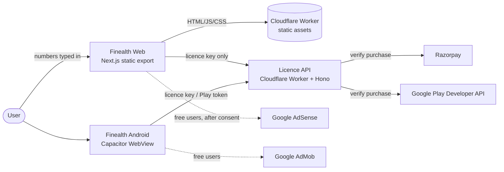
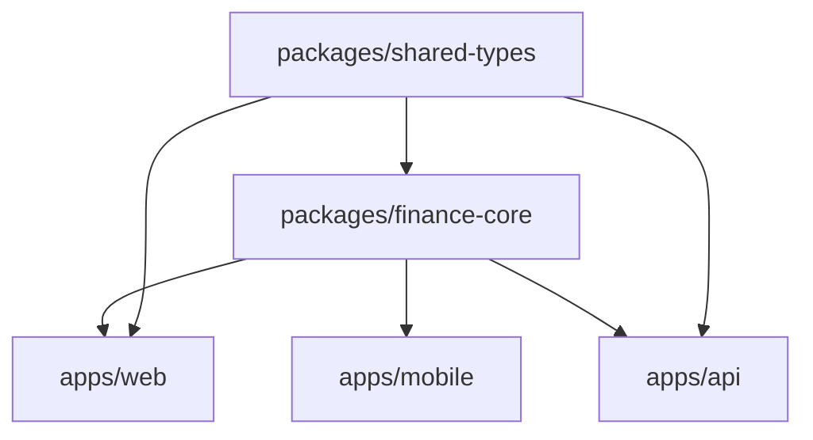
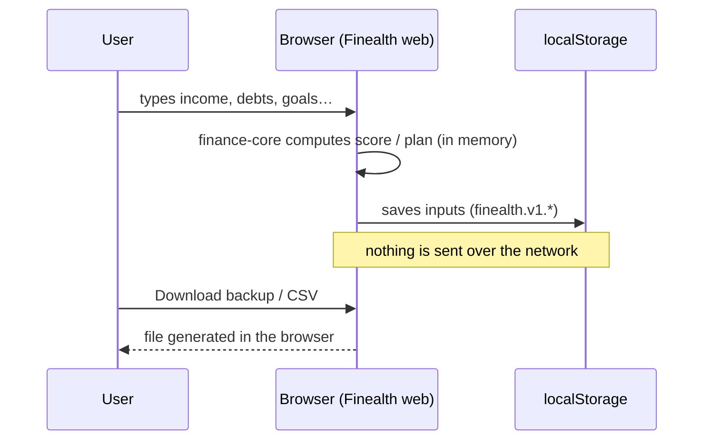

# 1. Purpose & scope
Finealth turns a few numbers a person already knows (income, spending, debts, savings, insurance) into a financial health score and a plan: which debt to clear first, the monthly saving each goal needs, and the chance retirement savings last. It also keeps the 20+ free calculators (SIP, EMI, compound interest, India/US/UK tax, GST/VAT, mortgage, FIRE) that bring search traffic.

Business model: freemium. Calculators, the health score and basic plans are free with ads. **Pro** (₹199 / US$7.99 a year, ₹499 / US$19.99 lifetime, ₹29 / US$0.99 a month on Android) adds the full report, unlimited debts and goals, what-if scenarios, Monte Carlo retirement odds, progress snapshots, CSV export and no ads. Market research and pricing rationale: `docs/competitor-analysis.md`.

Out of scope for v1: bank linking or account aggregation, investment product recommendations (regulated advice), user accounts, cloud sync.

# 2. Key decisions
| # | Decision | Rationale |
|---|---|---|
| D1 | Local-first: every financial number stays in the browser (`localStorage`) or app storage | Privacy is the product's promise and the finance category rule; no database to secure; zero cost |
| D2 | No bank linking | Bank sync needs paid aggregators (Plaid, Account Aggregator) and regulated data handling; breaks the zero-cost rule |
| D3 | Monorepo per Equisteg template v4 (npm workspaces + Turborepo) | One engine (`packages/finance-core`) shared by web and mobile; same tooling as InvoiceKit |
| D4 | Web = Next.js 16 static export served by a Cloudflare Worker (static assets) | Pre-rendered pages for SEO and AdSense; free hosting |
| D5 | No-signup Pro with a stateless licence Worker (same protocol as InvoiceKit) | No accounts, no database; Razorpay / Google Play are the only purchase records |
| D6 | Pro gating on the client, licence verified with an Ed25519 signature | Features are local maths; tampering only unlocks UI on the attacker's own device (accepted risk RSK-001) |
| D7 | Mobile stays a Capacitor wrapper of the static export for now | Ships today; move to Expo (template stack) is RSK-002 / next PR |
| D8 | Rules-of-thumb guidance, never product advice | Personalised investment advice is regulated (SEBI IA rules in India); category red line |

# 3. Context diagram

No financial data reaches any Finealth server. The only data that leaves the device is the licence key (Razorpay `pay_…`/`sub_…` id or Play purchase token) sent to the licence API.

# 4. Monorepo components
| Path | What it is | Depends on |
|---|---|---|
| `packages/finance-core` | Pure TypeScript engines: statutory calculators, health score, debt payoff, goals, retirement projection and Monte Carlo, loan prepayment, plan limits, CSV, licence token verify | `shared-types` |
| `packages/shared-types` | Licence claims, API request/response types | — |
| `apps/web` | Next.js App Router site: calculators (`/`), product pages under `app/(product)`, Pro provider, Razorpay checkout client | `finance-core`, `shared-types` |
| `apps/api` | Cloudflare Worker (Hono): `/api/v1/checkout`, `/checkout/confirm`, `/licence/verify`, `/play/verify`, `/errors`; serves `apps/web/out` | `shared-types`, `finance-core/licence` |
| `apps/mobile` | Capacitor Android/iOS shell around a static export | `finance-core` |
| `tests/` | Playwright web specs, Appium native spec, test-case sheets, bug log, load tests, guard tools | — |

# 5. Data flow

# 6. Third-party services
| Service | Use | Plan / cost | Data shared |
|---|---|---|---|
| Cloudflare Workers + Static Assets | Hosting web and API | Free (100k requests/day) | IP for delivery; no logs kept by us beyond 3 days |
| Razorpay | Web payments (subscription + one-time order) | Per-transaction fee | Buyer payment details (to Razorpay only) |
| Google Play Billing | Android payments | Play fee | Purchase token |
| Google AdSense / AdMob | Ads for free users | Revenue share | Standard ad-request data after consent |
| GitHub Actions | CI | Free tier | Source code |

# 7. Deployment topology
One Worker per environment (`dev`, `staging`, `production`, plus `prelaunch`) serves `apps/web/out` as static assets and runs code only for `/api/*`. Rate limits use Workers Rate Limiting bindings. No D1, KV or R2. Android builds come from `apps/mobile` (`npm run cap:sync`, Gradle).

# 8. Environments & env vars
| Variable | Where | Purpose |
|---|---|---|
| `NEXT_PUBLIC_SITE_URL` | web build | Canonical URLs, sitemap |
| `NEXT_PUBLIC_API_BASE` | web build | Licence API origin (empty = same origin) |
| `NEXT_PUBLIC_LICENCE_PUBLIC_KEY` | web build | Ed25519 public key to verify Pro tokens |
| `NEXT_PUBLIC_ENV` | web build | Refuse tokens from another environment |
| `NEXT_PUBLIC_RAZORPAY_ENABLED` | web build | `1` turns on the buy buttons |
| `NEXT_PUBLIC_ADSENSE_CLIENT`, `NEXT_PUBLIC_ADSENSE_SLOT_*` | web build | Ads |
| `LICENCE_SIGNING_KEY` | Worker secret | Ed25519 private key (never in git) |
| `RAZORPAY_KEY_ID` / `RAZORPAY_KEY_SECRET` | Worker var / secret | Razorpay API |
| `RAZORPAY_PLAN_ID_YEARLY_INR/USD` | Worker var | Yearly subscription plans |
| `PLAY_SERVICE_ACCOUNT` | Worker secret | Play Developer API |
| `KILL_SWITCHES` | Worker var + web build | e.g. `checkout` pauses new purchases |

# 9. Security architecture
- Browser and app are untrusted. Pro is granted only by a token signed by the licence Worker after the store confirms the purchase, valid ≤ 7 days and refreshed in the background, so refunds take effect within a week.
- The browser never sends a price: `/checkout` reads it from `apps/api/src/config/skus.ts`.
- Strict origin checks, JSON-only bodies, size limits and rate limits on every API route; constant-time Razorpay signature checks.
- No secrets in `NEXT_PUBLIC_*`. Pre-commit hook and CI block secret files and live keys (`tests/tools/check-forbidden-files.mjs`, Gitleaks, Semgrep, OSV-Scanner).
- CSV export escapes formula-leading cells (CSV injection).
- Pro users load no ad script at all.

# 10. Scalability & caching
All pages are static and cached at Cloudflare's edge; the maths runs on the user's device, so load grows only with licence checks (at most a few per user per week). Monte Carlo (1,000 runs × ≤ 80 years) completes in well under 100 ms on a mid-range phone.

# 11. Availability targets
Static pages: Cloudflare availability (pages keep working if the API is down). Licence API: 99.5 %; a failed refresh keeps Pro "unconfirmed" (no ads, Pro features locked) and retries every minute.

# 12. Monthly cost estimate
| Item | Cost |
|---|---|
| Hosting (Cloudflare free) | ₹0 |
| CI (GitHub free) | ₹0 |
| Domain | ~₹1,000 / year (NEEDS HUMAN) |
| Payments | Razorpay ~2 % + GST per sale; Play 15 % |

# 13. Risks
| ID | Risk | How we tackle it | Residual |
|---|---|---|---|
| RSK-001 | Pro gating is client-side | Accepted: features are local; tokens are signed and short-lived | Determined users can unlock UI on their own device |
| RSK-002 | Mobile is Capacitor, template says Expo | Next PR ports to Expo reusing `finance-core` | Play Billing not wired in the Capacitor app yet |
| RSK-003 | Rules of thumb read as advice | Disclaimer on every result, editorial policy, no product names | Low |
| RSK-004 | Overlap with PayCheckly (take-home pay) | Finealth leads with health score and plans; salary tools stay secondary | Low |
| RSK-005 | Statutory rates and thresholds change yearly | Dates in code comments; yearly re-check issue | Low |
