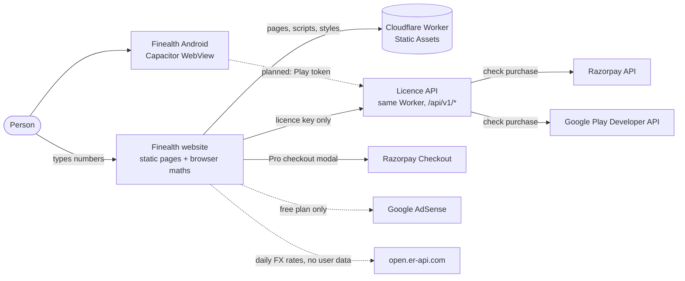
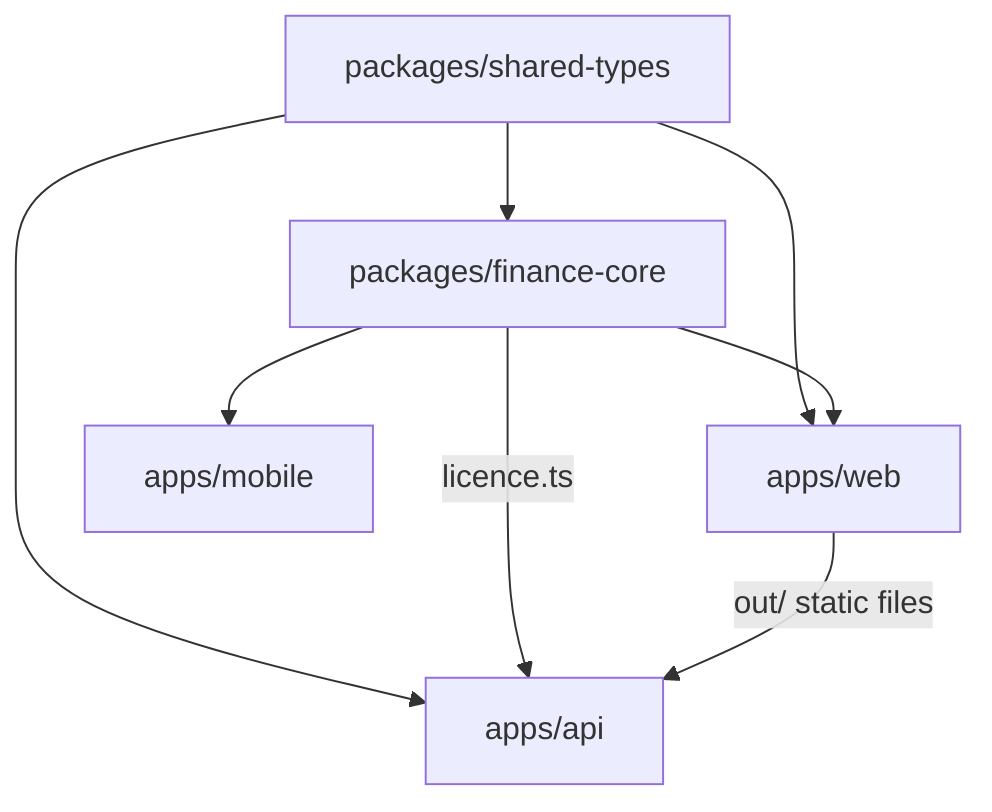
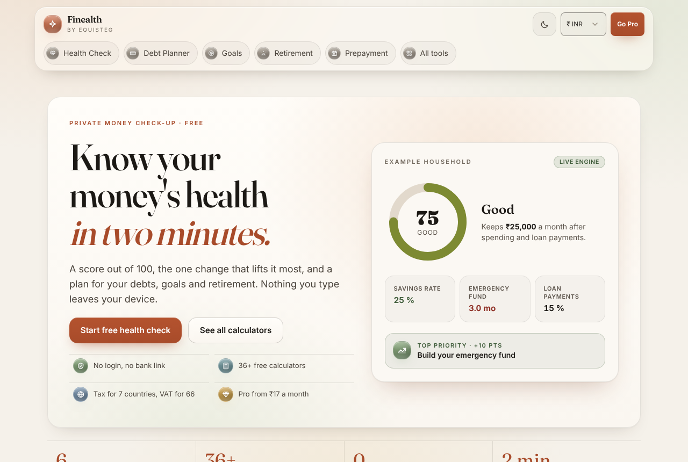
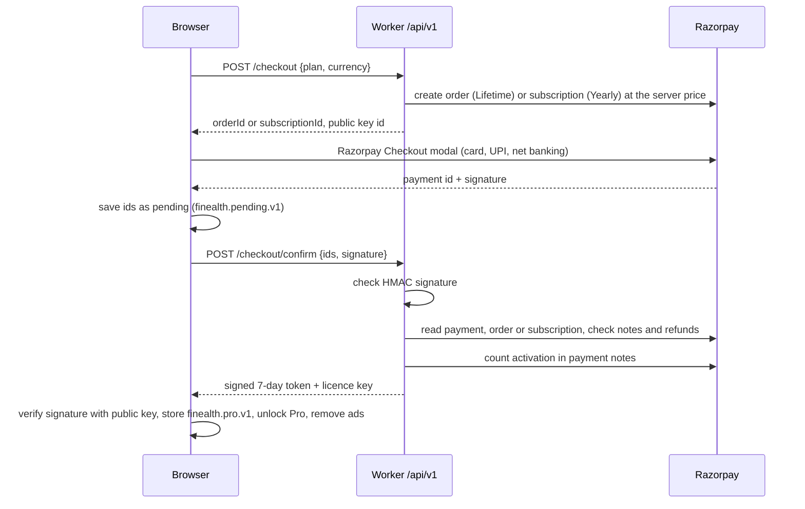
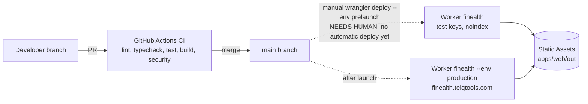

# 1. Purpose and scope
Finealth turns a few numbers a person already knows into a picture of their financial health and a plan. The numbers are income, spending, loan payments, savings, costly debt, investments, age, dependants and insurance. The result is a score out of 100, the one change that lifts it most, and planners for debts, goals, retirement and loan prepayment. Around the planners sit 36 free calculators (tax for 7 countries, VAT for 66 countries, loans, savings, everyday and business maths) plus the SIP, EMI and compound-interest pages and the regional quick calculators on the home page. These bring search traffic.

Finealth is an Equisteg product. Production lives at `https://finealth.teiqtools.com`.

**Business model: freemium.** Every calculator, the health score with the top action, the debt planner for 3 debts, 1 goal, the retirement projection, the prepayment optimiser and backup are free, with ads. **Pro** removes ads and adds the full report, unlimited debts and goals, what-if and schedule, retirement odds, snapshots and CSV export.

| Plan | India | International | Where it is sold |
|---|---|---|---|
| Free | ₹0 | $0 | Everywhere |
| Pro Yearly | ₹199 a year | US$7.99 a year | Web (Razorpay subscription); Android planned (Play Billing comes with the Expo port, RSK-002) |
| Pro Lifetime | ₹499 once | US$19.99 once | Web (Razorpay order); Android planned (RSK-002) |
| Pro Monthly | ₹29 a month | US$0.99 a month | Android only, not on sale yet (RSK-002) |

Display prices live in `packages/finance-core/src/plan.ts`. Charged prices live in `apps/api/src/config/skus.ts`, the Razorpay plans and Play Console. The four must match.

**Out of scope:** bank linking or account aggregation, naming investment products (regulated advice), user accounts, cloud sync, analytics.

# 2. Key decisions
| # | Decision | Why |
|---|---|---|
| D1 | Local-first. Every financial number stays in the browser (`localStorage`, keys `finealth.v1.*`) | Privacy is the product promise and a finance-category rule. No database to secure. Zero cost |
| D2 | No bank linking | Aggregators are paid and need regulated data handling. Breaks the zero-cost rule |
| D3 | Monorepo (npm workspaces + Turborepo), one engine `packages/finance-core` | Web, Android and the Worker run the same maths and the same licence code |
| D4 | Web is a Next.js 16 static export served by a Cloudflare Worker through Workers Static Assets | Pre-rendered HTML for SEO and AdSense. Free hosting. Pages keep working when the API is down |
| D5 | Production on `finealth.teiqtools.com`, a subdomain of TEIQTools.com (founder decision 9 Nov 2026, RSK-010) | No separate domain to buy. The Worker 301s other hosts on `/api/*` |
| D6 | No-signup Pro with a stateless licence Worker, same protocol as InvoiceKit | No accounts and no database. Razorpay and Google Play are the only purchase records |
| D7 | Pro gating on the client, unlocked only by an Ed25519-signed token valid at most 7 days | Pro features are local maths. Tampering unlocks only the attacker's own screen (accepted risk RSK-001) |
| D8 | Android stays a Capacitor shell around its own static export for now | Package `com.tezech.finealth` may already be on Play. The Expo port is RSK-002 |
| D9 | Rules of thumb with sources, never product advice | Personalised investment advice is regulated. Finance-category red line |
| D10 | Interim licence routes in Finealth's own Worker | The company platform Worker does not exist yet. The routes move there when it ships (RSK-108) |

# 3. System context

No financial number reaches any Finealth server. Three kinds of request leave the browser:

1. The licence key (a Razorpay `pay_…` or `sub_…` id) and, on refresh, the last Pro token, sent to the licence API.
2. The Razorpay Checkout modal, opened only when the person presses a buy button. Razorpay collects payment details itself.
3. For free users, the AdSense script. The site also fetches public exchange rates from `open.er-api.com` once per visit (see §14, item 3).

# 4. Components
| Path | What it is | Depends on |
|---|---|---|
| `packages/finance-core` | Pure TypeScript engines: health score, debt payoff, goals, retirement projection and Monte Carlo, prepayment, statutory calculators, country tax engines, universal tools, plan limits and prices, CSV, number formatting, licence token sign and verify | `shared-types` |
| `packages/shared-types` | Licence claims, plan names, API request and response types | none |
| `apps/web` | Next.js App Router site: home (`/`), product pages under `app/(product)`, 36 catalog tools under `/tools/[slug]`, Pro provider, Razorpay checkout client, AdSense loader | `finance-core`, `shared-types` |
| `apps/api` | Cloudflare Worker (Hono). Serves `apps/web/out` through the `ASSETS` binding and runs code only for `/api/*`: health, checkout, confirm, licence verify, Play verify, error reports | `finance-core/licence`, `shared-types` |
| `apps/mobile` | Capacitor Android (and iOS) shell around its own Next.js static export | `finance-core` |
| `tests/` | Robot Framework suites, Playwright specs, Appium spec, k6 load script, Lighthouse config, test-case workbook, bug log, guard tools | everything above |
| `scripts/` | Test-case builder, docs exporter, manual screenshots, licence key tools | |

# 5. The website
## 5.1 Pages
Every page is pre-rendered HTML with a trailing slash. The static export holds 55 pages: the home page, 17 product and legal pages, 36 tool pages and the 404 page.

| Area | Routes |
|---|---|
| Home | `/` |
| Planners | `/health-check/`, `/debt-payoff/`, `/goal-planner/`, `/retirement-planner/`, `/loan-prepayment/`, `/my-plan/` |
| Calculators | `/sip-calculator/`, `/emi-calculator/`, `/compound-interest/`, `/tools/` (index), `/tools/<slug>/` (36 tools) |
| Pro | `/pricing/`, `/pro/` (Restore Pro) |
| Company and legal | `/about/`, `/privacy/`, `/terms/`, `/refund/`, `/contact/` |
| Machine files | `/robots.txt`, `/sitemap.xml` (52 URLs: everything except `/pro/` and `/my-plan/`), `/ads.txt` |

Every page shares one frame: a "Skip to content" link, the floating `SiteHeader` (logo, light/dark toggle, currency menu, Go Pro or Pro badge, and a tab rail with Health Check, Debt Planner, Goals, Retirement, Prepayment and All tools), `<main id="main">`, and the `SiteFooter` with "A product by Equisteg" and the legal links.

## 5.2 Home page structure
The home page (v11 layout in the v10 "Warm Editorial" identity) is one vertical stack. Every section uses the same heading style (`SectionHead`) and spacing.

| # | Section | Component | Test id |
|---|---|---|---|
| 1 | Hero: headline, Start free health check, See all calculators, four trust chips, live example score card built by the real engine | `HomeHero` | `home-hero` |
| 2 | Proof strip: 6 planners, 36+ calculators, 0 numbers sent, 2 min | `ProofStrip` | `proof-strip` |
| 3 | Six planners as a bento grid | `PlannerCards` | `planner-bento` |
| 4 | How it works in three steps | `HowItWorks` | `how-it-works` |
| | Ad slot `top` (free plan only, between sections) | `AdSenseBanner` | |
| 5 | Markets at a glance: reference values, labelled "not live" | `app/page.tsx` | `markets` |
| 6 | Quick calculators for the chosen currency's country | `app/page.tsx` | `quick-calcs` |
| | Ad slot `mid` | `AdSenseBanner` | |
| 7 | Popular calculators (3 stand-alone pages + 6 library tools) | `PopularTools` | `popular-tools` |
| 8 | Free vs Pro with prices from `plan.ts` | `FreeVsPro` | `free-vs-pro` |
| 9 | Privacy promise | `PrivacyPromise` | `privacy-promise` |
| 10 | Five questions, with FAQPage JSON-LD | `HomeFaq` | `home-faq` |
| 11 | Final call to action | `FinalCta` | `final-cta` |
| | Disclaimer, then ad slot `bottom` | | `disclaimer` |

## 5.3 Look and feel
Colours are CSS variables: light "Paper" and dark "Espresso". The page follows the device setting until the person picks a mode with the toggle; the choice is stored in `finealth.theme`. Fonts are Inter (text) and Fraunces (headings). Motion switches off under reduced motion. On phones under 640 px the bento grid becomes two columns and the market cards become a sideways rail.

# 6. Shared engine
`packages/finance-core` holds every formula. It is pure, synchronous TypeScript with no DOM access, so the website, the Android app, the Worker and the Robot Framework engine bridge run the same code. Money inside loops is held in integer minor units (paise or cents) and rounded only at the end. Bad input (negative, `NaN`, infinite) counts as 0. Plans that cannot work return `feasible: false` with a plain-English reason instead of throwing. Every formula has a published source and golden unit tests. Details: LLD §4.

# 7. Android app
`apps/mobile` is a separate Next.js static export loaded by Capacitor (`appId com.tezech.finealth`, `webDir out`). It shows a splash, then four tabs (Wealth, Income, Debts, Macro) with 11 calculators: SIP, lump sum, SWP, fixed deposit, in-hand salary, India tax old vs new, GST, loan and EMI, loan compare, purchasing power and FIRE. It uses `finance-core` for formatting and formulas, sets the status bar and uses haptics.

It does **not** yet have the health check, the planners, Pro, Google Play Billing or AdMob. The Worker's `/api/v1/play/verify` route is ready for when it does. Porting the app to Expo with the full product is RSK-002.

# 8. Pro and licensing
## 8.1 Principles
- The browser and the app are untrusted. Only the store (Razorpay or Google Play) proves a payment.
- The Worker signs a Pro token only after the store confirms the purchase. The token is valid at most 7 days, so refunds and cancellations take effect within a week.
- The browser never sends a price. `/checkout` reads it from `skus.ts`.
- Nothing is stored on the server. The licence key is the Razorpay id of the purchase: `pay_…` for Lifetime, `sub_…` for Yearly. Razorpay notes `{ product: 'finealth', plan }` mark Finealth sales. The activation count lives in the payment's notes (`fh_activations`, at most 5 browsers).
- No `localStorage` flag, success URL or unsigned claim ever grants Pro.

## 8.2 Buying on the web

If the tab closes or the network drops after payment, the pending ids are retried on the next page loads. The buyer also sees the id to paste on Restore Pro. A paid purchase is never lost.

## 8.3 Restore and refresh
- **Restore Pro** (`/pro/`): the person pastes the `pay_…` or `sub_…` id. The Worker checks it with Razorpay, counts an activation and returns a token.
- **Refresh**: on every page load the stored token is verified locally. When less than 2 days are left, the browser asks for a new token and sends the old one as proof, so a refresh does not count as a new activation.
- **Outcomes**: refunded, invalid or ended means the licence is removed and a calm notice shows. A network error or outage keeps Pro while the old token is valid; after that the state is "unconfirmed" (no Pro features, no ads) and it retries every minute.
- A device clock set back by more than an hour cannot keep an old token alive offline.

## 8.4 Android purchases (ready, not yet wired)
`POST /api/v1/play/verify` takes `{ purchaseToken, productId, kind }`, reads the purchase from the Google Play Developer API v3 with a service account, and returns a token. Subscription `pro` has base plans `monthly` and `yearly`. The one-time product is `pro_lifetime`.

# 9. Ads and consent
- Web ads are Google AdSense only. Publisher `ca-pub-1503863859594756`, listed in `/ads.txt`.
- `AdLoader` adds the AdSense script only for a confirmed free user: never while the licence is checked, never when a licence is stored, never for Pro. Pro users download no ad code.
- Four slots: `top`, `mid` and `bottom` on the home page, between sections, and `calculator` under each planner and tool page after the disclaimer. Ads never sit beside a control or inside a result. A slot without an id renders nothing on production; dev and staging builds show a labelled placeholder.
- Consent in the EEA, UK and Switzerland must come from Google's certified consent message before ads load. The code does not include its own consent banner. See §14, item 2.
- Mobile ads must be AdMob only. The Android app has no ad SDK today. See §14, item 1.

# 10. Data and privacy
| Data | Where it lives | Leaves the device? |
|---|---|---|
| Health, debts, goals, retirement inputs, snapshots | `localStorage` under `finealth.v1.*` | Never. Backup and CSV files are made in the browser |
| Pro licence (key, plan, token) | `finealth.pro.v1` | The key and token go to the licence API only |
| Pending checkout ids | `finealth.pending.v1` | To `/checkout/confirm` only |
| Light or dark choice | `finealth.theme` | Never. Not part of backups |
| Payment details | Razorpay or Google Play | Collected by the store, never seen by Finealth |

The Worker logs one scrubbed JSON line per request: request id, method, path, status and time. It never logs the IP, body or query. Licence keys appear only as an 8-character hash fingerprint. Workers Logs keep 3 days.

# 11. Deployment and environments

| Environment | Worker | Purpose | Razorpay keys | Token `env` |
|---|---|---|---|---|
| `dev` | `finealth-dev` on `*.workers.dev` | Manual testing | `rzp_test_` only | `dev` |
| `staging` | `finealth-staging` on `*.workers.dev` | Full test suite | `rzp_test_` only | `staging` |
| `prelaunch` | `finealth` | Test site until launch, hidden from search | `rzp_test_` only | `staging` |
| `production` | `finealth` | `finealth.teiqtools.com` | `rzp_live_` only | `production` |

The Worker refuses a Razorpay key of the wrong mode. Each environment has its own Workers Rate Limiting namespaces: strict 5 requests a minute per IP for licence, Play, checkout and confirm; 120 a minute for other API routes.

**Transition note.** The repository still has one long-lived branch, `main`, and `main` does not deploy by itself. The template's `development → staging → production` branches and the `deploy.yml` workflow are NEEDS HUMAN (`docs/MIGRATION-cloudflare.md` §6). Today the only workflow is `.github/workflows/ci.yml`.

**Build-time variables (web, public):** `NEXT_PUBLIC_SITE_URL`, `NEXT_PUBLIC_API_BASE`, `NEXT_PUBLIC_LICENCE_PUBLIC_KEY`, `NEXT_PUBLIC_ENV`, `NEXT_PUBLIC_RAZORPAY_ENABLED`, `NEXT_PUBLIC_KILL_SWITCHES`, `NEXT_PUBLIC_NOINDEX`, `NEXT_PUBLIC_CONTACT_EMAIL`, `NEXT_PUBLIC_PLAY_URL`, `NEXT_PUBLIC_BUSINESS_ADDRESS`, `NEXT_PUBLIC_ADSENSE_CLIENT`, `NEXT_PUBLIC_ADSENSE_SLOT_TOP/MID/BOTTOM/CALCULATOR`, `NEXT_PUBLIC_AD_PLACEHOLDERS`. None of these may hold a secret.

**Worker variables:** `ENVIRONMENT`, `RELEASE`, `CANONICAL_HOST`, `ALLOWED_ORIGINS`, `RAZORPAY_KEY_ID`, `RAZORPAY_PLAN_ID_YEARLY_INR`, `RAZORPAY_PLAN_ID_YEARLY_USD`, `RAZORPAY_PLAN_IDS_YEARLY_LEGACY`, `KILL_SWITCHES`, `MAX_ACTIVATIONS`, `PLAY_PACKAGE_NAME`, `PLAY_SUBSCRIPTION_ID`, `PLAY_LIFETIME_PRODUCT_ID`. **Worker secrets** (set with `wrangler secret put`, never in git): `LICENCE_SIGNING_KEY`, `RAZORPAY_KEY_SECRET`, `GOOGLE_PLAY_SA_KEY`.

# 12. Security
- Browser and app untrusted; Pro only from a signed, short-lived token (§8).
- Every API route: canonical-host redirect on production, CORS allow-list with no credentials, a foreign `Origin` refused, JSON-only bodies (blocks form-based CSRF), 16 KB body limit (4 KB for error reports), per-IP rate limits, `no-store` and strict security headers on every API response.
- Razorpay signatures are checked with HMAC-SHA256 through WebCrypto (constant-time).
- One message for every bad licence key, so the API never reveals whether a key exists.
- CSV export prefixes formula-like cells with `'` (CSV injection).
- Secrets: pre-commit hook and CI block secret files and live keys (`tests/tools/check-forbidden-files.mjs`, Gitleaks, Semgrep CE, OSV-Scanner). The secrets guard is `.claude/hooks/guard-secrets.mjs`.
- Static page headers: `apps/web/public/_headers` sets HSTS, `nosniff`, `X-Frame-Options: DENY`, a referrer policy and a permissions policy on every page. A page Content-Security-Policy is still open (RSK-015, §14 item 4).

# 13. Reliability and self-healing
Finealth runs the reduced, database-free version of `docs/standards/self-healing.md` ("Finealth deviation").

| Control | Status |
|---|---|
| Static pages served before the Worker runs | Live. Calculators and planners keep working when the API is down (NFR-008) |
| `/api/v1/health` reports release, environment, signing key and Razorpay config (config only: a Razorpay or Play outage shows as 503 on purchase checks, RSK-022) | Live |
| Retries: one retry with a short pause on network errors and 5xx from Razorpay and Google (`fetchWithRetry`, 8 s timeout) | Live |
| Store outage: 503 for new checks while existing tokens stay valid up to 7 days | Live |
| Kill switch `checkout` pauses new purchases (Worker `KILL_SWITCHES`, web `NEXT_PUBLIC_KILL_SWITCHES`); verify and confirm are never switched off | Live, switched by a redeploy or `wrangler rollback` |
| Rate-limit binding outage falls back to per-isolate limits, never fails open | Live |
| Scrubbed Workers Logs, one line per request; `/api/v1/errors` for client error reports | Live. No client sends error reports yet |
| Deploy health check, 10-minute canary and auto-rollback (`deploy.yml`) | Planned. Workflow not yet in the repo |
| External uptime monitor on `/` and `/api/v1/health` | NEEDS HUMAN |
| Incident issue to `auto-debug.yml` to an `auto-fix` PR | Planned |
| D1 stats, watchdog cron, KV kill switches, KV circuit breaker | Dropped (no database, by design) |

# 14. Known gaps found while writing this version
Each item follows `docs/standards/risks-and-issues.md`: how we tackle it, what was done in this run, the automatic response in production, and the residual. Open items are rows in `docs/risk-register.md`.

1. **Android "Sponsored" card (fixed).** The app showed a hard-coded, non-AdMob card naming financial products. Tackle: eliminate. Done in this run: the card is removed and every app result now carries the disclaimer (TC-M-APP-003, TC-N-CMPL-005). Residual: none; AdMob arrives with the Expo port (RSK-002).
2. **No consent message wired for AdSense (RSK-017).** The code loads AdSense for free users with no consent banner of its own. Tackle: reduce (turn on Google's certified consent message in AdSense "Privacy & messaging" for EEA, UK and Switzerland, NEEDS HUMAN, then add an automated check). Done now: logged. Production response: none. Residual: medium (ad slots are still unset, so no ads serve yet).
3. **Unused exchange-rate call (RSK-016).** `CurrencyContext` fetches `open.er-api.com` once per visit but nothing on screen uses the rates; the visitor's IP reaches a third party the Privacy page does not name. Tackle: eliminate (remove the fetch) or name the service; founder picks. Residual: low.
4. **Security headers on static pages (RSK-015, partly fixed).** `apps/web/public/_headers` was referenced but missing. Done in this run: the file now sets HSTS, nosniff, frame DENY, referrer and permissions policy (TC-N-SEC-006 passes). Still open: a page Content-Security-Policy (TC-N-SEC-008 fails until then); next step is a report-only CSP on staging listing AdSense, consent and Razorpay origins. Residual: medium.
5. **Deploy and self-healing workflows missing (RSK-018).** Only `ci.yml` exists. Tackle: add `deploy.yml` with the health check, canary and rollback, then `scheduled.yml` and `auto-debug.yml`. Residual: medium until then.

# 15. Non-functional requirements
| NFR | Area | Target | How it is tested |
|---|---|---|---|
| NFR-001 | Accuracy | Golden formula cases 100 % match | Vitest golden tables in `packages/finance-core` |
| NFR-002 | Performance | Monte Carlo 1,000 runs × 80 years < 100 ms on a mid-range phone | Robot NFR suite (`tests/automation/web/nfr/performance.robot`) |
| NFR-003 | Performance | Lighthouse performance ≥ 90 on the home, planner, pricing and one tool page | `tests/load/lighthouserc.json` (8 pages, 3 runs, also accessibility and best practices ≥ 0.9) |
| NFR-004 | Privacy | 0 requests carry form values | Robot `No Request Should Carry`, Playwright |
| NFR-005 | Privacy | Pro loads 0 ad scripts | Robot `Page Should Load No Ad Script` |
| NFR-006 | Security | Tampered token means free | Robot `Tamper Pro Token`, licence unit tests, API tests |
| NFR-007 | Security | 0 secrets in repo or bundle | Gitleaks on the tree and on the built bundle, forbidden-files check |
| NFR-008 | Reliability | Static pages work with the API down | Robot and Playwright with the API blocked |
| NFR-009 | Accessibility | 0 serious or critical axe issues, light and dark | Robot `Page Should Pass Axe`, Playwright `a11y.spec.ts` |
| NFR-010 | Compliance | Disclaimer on every result screen | Robot `Disclaimer Should Be Visible` |
| NFR-011 | Compatibility | No horizontal scroll at 360 px | Robot `Page Has No Horizontal Scroll` |
| NFR-012 | Load | Licence API p95 < 300 ms, errors < 1 % at 20 rps | k6 `tests/load/load.js` on staging only |
| NFR-013 | Performance | CLS < 0.1 on the debt planner and home page at 412 px | Robot `Get Layout Shift` |
| NFR-015 | Compliance | Tax rates carry a last-checked date under 12 months old | `RATES_LAST_CHECKED` = 9 Nov 2026, shown on every tax tool |

## 15a. Requirements → design
Every requirement in `docs/product-brief.md` §4 and where this HLD and the LLD design it. Test cases for each are in `docs/test-cases.md`.

| REQ | Requirement | HLD | LLD |
|---|---|---|---|
| REQ-001 | Health check score | §5.1, §6 | §4.1, §2 |
| REQ-002 | Health action plan | §5.1, §6 | §4.1, §5 |
| REQ-003 | Debt payoff planner | §5.1, §6 | §4.2 |
| REQ-004 | Debt what-if and schedule (Pro) | §8 | §4.2, §5 |
| REQ-005 | Goal planner | §5.1, §6 | §4.3, §5 |
| REQ-006 | Retirement projection | §5.1, §6 | §4.4 |
| REQ-007 | Retirement odds (Pro) | §8 | §4.4, §5 |
| REQ-008 | Loan prepayment | §5.1, §6 | §4.5 |
| REQ-009 | Local storage, backup and restore | §10 | §6 |
| REQ-010 | Progress snapshots (Pro) | §10 | §5, §6 |
| REQ-011 | Pricing and checkout | §1, §8.2 | §8, §9 |
| REQ-012 | Restore Pro and licence token | §8.3 | §3.5, §7 |
| REQ-013 | Ads gating | §9 | §3.4 |
| REQ-014 | Disclaimer and legal pages | §5.1, §10 | §2, §3.3 |
| REQ-015 | Calculators | §5.1 | §2, §4.6 |
| REQ-016 | CSV export | §10, §12 | §6 |
| REQ-017 | SEO | §5.1 | §2 |
| REQ-018 | Licence API | §8, §12 | §8 |
| REQ-019 | Global tools library | §5.1 | §2.1, §4.6 |
| REQ-020 | Country tax engines | §6 | §4.7 |
| REQ-021 | Payment acknowledgement and disclaimers | §8.2 | §2, §10 |
| REQ-022 | Gap-free tool layouts, key figures in the heading | §5.3 | §3.3 |
| REQ-023 | Warm Editorial look, light and dark | §5.3 | §3.1 |
| REQ-024 | One header and footer, skip link, stable layout | §5.1, §5.3 | §3.1 |
| REQ-025 | Home page | §5.2 | §3.2 |

# 16. QA architecture
Testing follows the company standard `docs/standards/qa-architecture.md`, adopted from ClearFile on 10 Nov 2026. The main Claude session builds and fixes. Read-only reviewer agents in `.claude/agents/` plan, check and report with a fresh context. No agent edits files.

| Role | Agent | Owns |
|---|---|---|
| QA Lead | `qa-lead` | Test strategy and plan, scope, entry and exit criteria, risk-based priority, traceability, triage policy, test report, go / no-go |
| Functional QA | `qa-functional` | Test design from requirements, HLD, LLD and manual: positive, negative, edge, boundary; money-maths and UI bug hunting |
| Automation QA | `qa-automation` | Robot Framework, Playwright, Appium, Vitest and Worker tests: keyword and locator design, test data, flakiness, coverage |
| Non-functional QA | `qa-nonfunctional` | Accuracy, performance, load, security, accessibility, compatibility, privacy and compliance against each NFR |
| Reliability Engineer | `reliability-engineer` | SLOs, monitoring, canary and rollback, kill switches, retries, runbooks, free-tier headroom |
| Requirements reviewer | `requirements-reviewer` | HLD, LLD, User Manual (with its screenshots) and on-screen help match the brief, CLAUDE.md and the code |
| Solution architect | `solution-architect` | Whole-product architecture, headroom, licence model, accuracy approach, roadmap |

Other specialists stay: `code-reviewer`, `scope-guard`, `security-auditor`, `payments-auditor`, `category-reviewer`, `ux-a11y-reviewer`, `seo-ai-reviewer`, `store-policy-reviewer`, `marketing-claims-reviewer`, `test-traceability-auditor`, `incident-investigator` and `release-gate` (roster in `.claude/agents/README.md`).

**Test pyramid.** Unit (engine golden tables, web libraries) → integration (Worker routes with faked Razorpay and Google) → end-to-end (Robot Framework suites, one test per TC ID, plus Playwright twins and the Appium device spec) → non-functional (Lighthouse, k6, axe, security scanners) → production checks. Logic is tested at the lowest level that can prove it. End-to-end tests prove journeys and the figure on screen.

**Severity.** S1: a wrong money figure shown as fact, financial input leaving the device, a paid user losing Pro, a security hole, a crash in a core journey. S2: core feature wrong with no workaround, a missing disclaimer, or wording that reads as personal advice. S3: wrong with a workaround, accessibility failures. S4: cosmetic. Test priority P1 must pass to release.

**Exit to production.** No open S1 or S2 bug, every P1 case passed on staging, every NFR at its threshold or accepted by a founder, reliability readiness PASS, no residual high risk. Production is never load-tested, never bought from and never has its ads clicked.

Details of the tools and files: LLD §11.

# 17. Cost
| Item | Cost |
|---|---|
| Hosting (Cloudflare Workers free: 100,000 requests a day) | ₹0 |
| CI (GitHub Actions free) | ₹0 |
| Domain | ₹0 (subdomain of TEIQTools.com) |
| Payments | Razorpay fee per sale; Google Play service fee |

# 18. Risks
| ID | Risk | How we tackle it | Residual |
|---|---|---|---|
| RSK-001 | Pro gating is client-side | Accepted: features are local maths; tokens are signed and short-lived | A determined user unlocks only their own screen |
| RSK-002 | Android is Capacitor, not Expo, and lacks the planners, Pro and AdMob | Port to Expo reusing `finance-core` | Android app is a calculator set only |
| RSK-003 | Rules of thumb read as advice | Disclaimer on every result, sources shown, no product names | Low |
| RSK-005 | Statutory rates change yearly | Last-checked date on every tax tool, yearly re-check | Low |
| RSK-007 | Activation counter is best effort (two activations at once can both pass) | Accepted as in InvoiceKit | Low |
| RSK-010 | Subdomain instead of own domain | Founder decision; canonical host and 301 | Low |
| RSK-108 | Licence routes live in Finealth, not the platform Worker | Move when `equisteg-platform` ships | Low. Not yet a row in `docs/risk-register.md` |

The full list, with owners, is in `docs/risk-register.md`.
