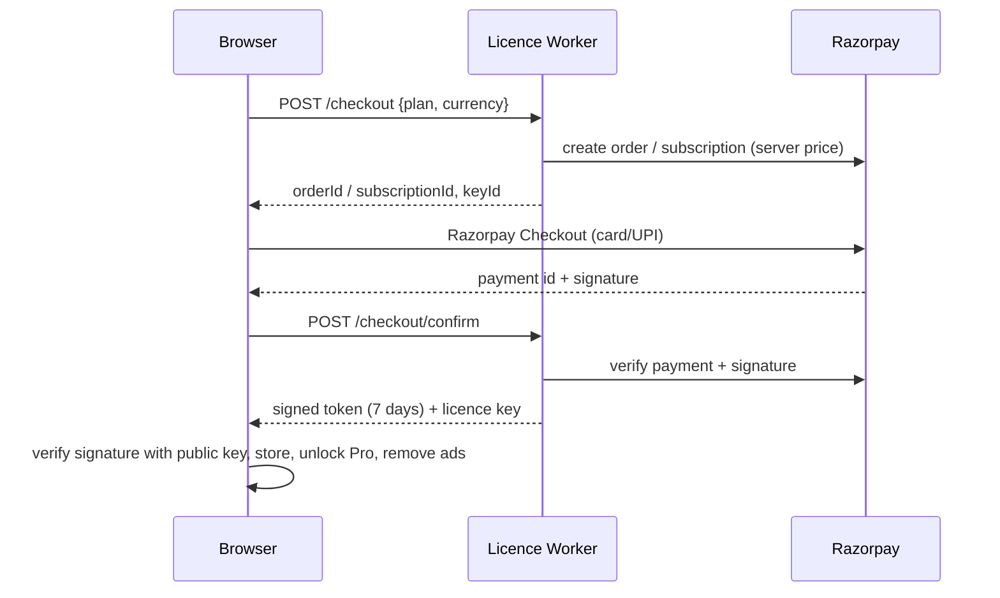
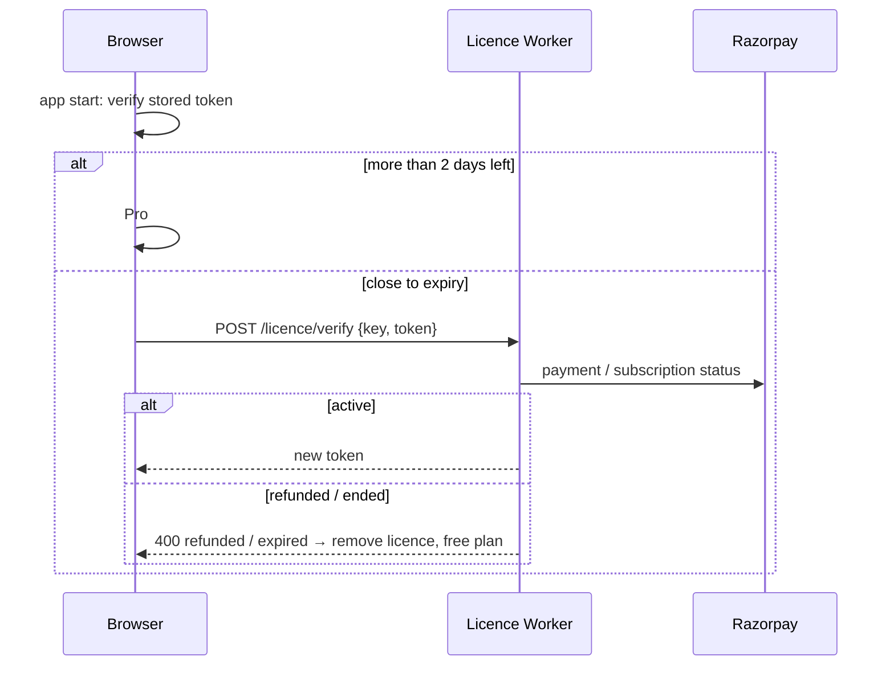

# 1. Workspace structure
```
finance-calculators/
├── apps/
│   ├── web/            @finealth/web     Next.js 16 static export
│   │   └── src/
│   │       ├── app/                 / (calculators), sip/emi/compound routes, robots, sitemap
│   │       ├── app/(product)/       health-check, debt-payoff, goal-planner, retirement-planner,
│   │       │                        loan-prepayment, my-plan, pricing, pro, about, privacy, terms, refund, contact
│   │       ├── components/          ProProvider, PriceCards, ActivatePro, AdLoader, AdSenseBanner, ui.tsx, site/, tools/
│   │       └── lib/                 config, ads, pro, checkout, storage, usePersistent
│   ├── api/            @finealth/api     Cloudflare Worker (Hono)
│   └── mobile/         @finealth/mobile  Capacitor shell (android/, ios/)
├── packages/
│   ├── finance-core/   formulas + licence verify (pure TS, no DOM)
│   └── shared-types/   API and token types
├── tests/              web/ (Playwright), mobile/native (Appium), cases/, bugs/, load/, tools/
├── scripts/            test-cases.mjs, docs-export.mjs, gen-licence-keys.mjs, make-test-licence.mjs
└── docs/               HLD, LLD, USER_MANUAL, test-cases, standards/
```

# 2. Shared types (`@finealth/shared-types`)
| Type | Fields |
|---|---|
| `ProPlan` | `'pro_monthly' \| 'pro_yearly' \| 'pro_lifetime'` |
| `LicenceClaims` | `v: 1`, `plan`, `src: 'razorpay' \| 'play'`, `iat`, `exp` (≤ 7 days), `kh?` (16-byte key hash), `env?` |
| `CheckoutRequest` | `plan: 'pro_yearly' \| 'pro_lifetime'`, `currency: 'INR' \| 'USD'` |
| `LicenceResponse` | `token`, `plan`, `exp`, `licenceKey?` |

# 3. `@finealth/finance-core` contracts
All functions are pure and synchronous. Inputs that are negative, `NaN` or infinite are treated as 0. Money inside loops is integer minor units (paise/cents); results are rounded to whole units (or 2 dp for schedules) only at the end.

| Module | Function | Returns |
|---|---|---|
| `health.ts` | `financialHealth(input, fmt?)` | `{ score 0-100, grade, pillars[6], actions[] (ranked), metrics }` |
| `debt.ts` | `planDebtPayoff(debts, budget, strategy)` | `{ feasible, reason?, months, totalInterest, totalPaid, payoffs[], schedule[] }` |
| `debt.ts` | `compareDebtStrategies(debts, budget)` | minimum / avalanche / snowball plans, `best`, `interestSaved`, `monthsSaved` |
| `goals.ts` | `planGoal(goal)`, `planGoals(goals, budget)` | future cost, savings growth, gap, monthly needed, allocation by priority |
| `retirement.ts` | `projectRetirement(input)` | corpus at retirement, corpus needed, run-out age |
| `retirement.ts` | `retirementOdds(input, runs = 1000, seed)` | success rate, p10/p50/p90 corpus, median run-out age |
| `prepayment.ts` | `comparePrepayment(input)` | EMI, baseline, reduce-tenure and reduce-EMI options, `better` |
| `plan.ts` | `FREE_LIMITS`, `PRO_FEATURES`, `PLAN_PRICES`, `limitFor()` | display-only prices (server prices in `apps/api/src/config/skus.ts`) |
| `tools.ts` | universal tools (see 3.6) | inflation, real return, CAGR, doubling time, simple interest, RD, yearly deposit (PPF), savings target, retirement corpus, NPV, IRR, XIRR, card payoff, affordability, true loan rate, flat-rate loan, rent vs buy, 50/30/20, emergency fund, net worth, percentages, discount, margin, break-even, salary, tip |
| `world.ts` | `australiaTax`, `canadaTax`, `singaporeTax`, `newZealandTax`, `CA_SALES_TAX`, `WORLD_VAT_RATES`, `RATES_LAST_CHECKED` | country tax engines (see 3.7) |
| `csv.ts` | `toCsv(header, rows)` | RFC 4180 text with formula-injection guard |
| `licence.ts` | `verifyLicence`, `signLicence`, `licenceKeyHash` … | Ed25519 token helpers (WebCrypto) |

## 3.1 Health score
Six pillars, each 0-100, weighted sum rounded to a whole number (float noise trimmed first).

| Pillar | Measure | Full marks | Zero | Weight | Source |
|---|---|---|---|---|---|
| Savings rate | (income − spending − loan payments) / income | ≥ 20 % | ≤ 0 % | 20 % | 50/30/20 rule |
| Emergency fund | savings / (spending + loan payments) | ≥ 6 months | 0 | 20 % | CFPB emergency-fund guide (3-6 months) |
| Debt payments | loan payments / income | ≤ 10 % | ≥ 50 % | 20 % | CFPB debt-to-income (36 % / 43 %) |
| Costly debt | card + personal-loan balance / yearly income | 0 | ≥ 50 % | 10 % | — |
| Retirement | investments / yearly income vs age multiple | ≥ target | 0 | 15 % | Fidelity: 1× at 30, 3× at 40, 6× at 50, 8× at 60, 10× at 67 (linear between) |
| Protection | life cover / yearly income (if dependants) and health cover | 10× and yes | none | 15 % | Income-replacement rule (IRDAI consumer education) |

Grades: ≥ 80 Excellent, ≥ 60 Good, ≥ 40 Fair, else Needs attention. Actions are ranked by points recoverable = (100 − pillar score) × weight. Golden case: the example household scores **75 / Good** (`planning.test.ts`).

## 3.2 Debt payoff
Each month, for every open debt: interest = round(balance × APR / 1200) is added; the minimum (or whole balance) is paid; the rest of the budget goes to the first open debt in strategy order and rolls to the next when one is cleared. Avalanche = highest APR first (ties: smaller balance); snowball = smallest balance first; custom = list order; minimum = minimums only, no roll-over. Infeasible when budget < sum of minimums, when month 1 payments do not cover interest, or after 600 months. Golden: ₹1,000 at 12 % paying ₹100 → 11 months, ₹58.98 interest (closed form n = −ln(1 − rB/P)/ln(1 + r) = 10.59).

## 3.3 Goals
future cost = cost × (1 + inflation)^years; savings grow at (1 + r/12)^(12·years); monthly saving = gap / F where F = ((1 + i)^n − 1)/i × (1 + i) (annuity-due, i = r/12, n = 12·years), or a month-by-month sum when stepping up yearly. Rounded **up** so the goal is met. Golden: ₹10 lakh in 10 years at 6 % inflation, 12 % return → future cost ₹17,90,848, ₹7,708 a month.

## 3.4 Retirement
Yearly model. Working years: corpus = (corpus + 12 × monthly saving) × (1 + r). Retired years: corpus −= spending, then × (1 + r_retired); spending grows with inflation. Corpus needed = present value at retirement of the growing spending stream. Monte Carlo: yearly return ~ Normal(mean, volatility) with mulberry32 seeded PRNG and Box-Muller; retired volatility is scaled by r_retired / r; a year cannot lose more than 95 %. With volatility 0 the odds equal the straight-line verdict (test).

## 3.5 Prepayment
EMI = P·r·(1 + r)^n / ((1 + r)^n − 1). Reduce tenure: keep EMI (+ extra monthly) on the reduced balance and amortise until zero. Reduce EMI: new EMI over the same remaining months. Golden: ₹10 lakh, 9 %, 240 months, ₹1 lakh prepaid → EMI ₹8,997.26, new EMI ₹8,097.53, tenure 186 months (54 saved).

## 3.6 Universal tools (`tools.ts`)
| Tool | Formula | Source / golden |
|---|---|---|
| Inflation | FV = PV(1 + i)ⁿ; buying power = PV / (1 + i)ⁿ | ₹1,00,000 at 6 % for 10 y → ₹1,79,085 / ₹55,839 |
| Real return | (1 + n)/(1 + i) − 1 (Fisher) | 10 % and 6 % → 3.77 % |
| CAGR | (end/start)^(1/y) − 1 | 1 → 2 in 5 y → 14.87 % |
| Doubling | ln 2 / ln(1 + r); Rule of 72 = 72/r | 8 % → 9.01 y / 9 y |
| RD | Σ P(1 + r/4)^(4(n − k + 1)/12), quarterly compounding (Indian bank method) | ₹5,000 × 12 at 7 % → ₹62,311 |
| PPF / yearly deposit | annuity-due, yearly compounding | ₹1.5 L × 15 y at 7.1 % → ₹40,68,209 (matches published calculators) |
| Savings target | gap / (((1 + i)ⁿ − 1)/i), i = r/12, after growing current savings | ₹10 L in 10 y at 12 % → ₹4,347 |
| Retirement corpus | Σ month k: E(1 + g)ᵏ / (1 + r)ᵏ, monthly equivalents of yearly rates | return = inflation → months × expense |
| NPV / IRR | Σ CFₜ/(1 + r)ᵗ; IRR by bisection on (−99.99 %, 10⁶ %) | −1000, 300, 400, 500 at 10 % → −21.04; IRR ≈ 8.9 % |
| XIRR | Σ CFᵢ/(1 + r)^(days/365) = 0 (spreadsheet convention) | +10 % over one year → 10 % |
| Card payoff | monthly interest at APR/12 before payment; capped at 600 months | 5,000 at 24 % paying 200 → 36 months, 2,001 interest |
| Affordability | max payment = income × limit − debts; loan = PMT(1 − (1 + r)⁻ⁿ)/r | 1,00,000, 50 %, 10,000, 9 %, 20 y → ₹44,45,798 |
| True loan rate | solve PV(payments) = principal − fees, × 12 | no fee → quoted rate |
| Flat rate | interest = P·r·t on the original amount; equivalent reducing rate solved | 1 L at 10 % flat, 3 y → EMI 3,611, ≈ 17.9 % reducing |
| Rent vs buy | month-by-month: both spend the same, the cheaper side invests the difference; buyer's wealth = home value × (1 − selling costs) − loan + invested | ignores tax |
| 50/30/20 | Warren & Tyagi (2005) | — |

## 3.7 Country tax engines (`world.ts`, `finance.ts`)
Rates last checked **9 Nov 2026** (`RATES_LAST_CHECKED`, shown on every tax tool with a link to the official calculator).

| Engine | Rules | Golden |
|---|---|---|
| Australia 2026-27 | ATO resident rates 0/15/30/37/45 % at 18,200/45,000/135,000/190,000; LITO $700 tapering 5c over 37,500 and 1.5c over 45,000; Medicare 2 % with 10 % shade-in over $27,222 | A$90,000 → tax $17,520, Medicare $1,800 |
| Canada 2026 | federal 14/20.5/26/29/33 % at 58,523/117,045/181,440/258,482; BPA 16,452 → 14,829; credits at 14 % on BPA, employment amount 1,501, base CPP and EI; enhanced CPP and CPP2 deducted; CPP 5.95 % (YMPE 74,600, exemption 3,500), CPP2 4 % to 85,000, EI 1.63 % to 68,900; provincial = flat estimate | C$60,000 → federal $5,338, CPP $3,362, EI $978 |
| Singapore (YA 2025 on) | resident rates 0-24 %; CPF employee 20 % to the S$8,000 monthly ceiling; earned income relief S$1,000 | S$60,000 → tax $1,040 |
| New Zealand | 10.5/17.5/30/33/39 % at 15,600/53,500/78,100/180,000; ACC levy editable | NZ$80,000 → $16,278 |
| US 2026 joint | Rev. Proc. 2025-32: brackets 24,800 … 768,700, standard deduction 32,200, Additional Medicare from 250,000 | $150,000 → federal $15,340 |
| India old regime | age bands (₹2.5 L / 3 L / 5 L exemption); 80D capped separately for self (₹25k, ₹50k if 60+) and parents (₹25k, ₹50k if 60+); HRA = least of three limits; gratuity = wage × 15/26 × years, > 6 months rounds up, cap ₹20 L | ₹15 L with 80D 40k + 60k (senior parent) → 80D ₹75,000, tax ₹1,87,200 |
| UK SDLT | + 2 % non-resident surcharge on the whole price | £300k → +£6,000 |
| World VAT | standard rates for 27 EU states + 40 other countries (no Pakistan); `EU_STANDARD_VAT_RATES` must equal the EU rows (test) | DE 119 incl. → 19.00 VAT |

**Audit, Nov 2026.** Fixed: 80D used one ₹1 L cap for everyone (now separate caps; under-60 with senior parents max ₹75,000); EU VAT lacked BG, HR, CY, CZ, LV, LT, MT, SI; old regime ignored senior-citizen exemptions; US had single filers only; SDLT lacked the non-resident surcharge. Re-verified unchanged: India new-regime slabs, 87A marginal relief and surcharge relief (₹13 L → ₹26,000; ₹60 L → ₹15,52,980), US 2026 single ($80,000 → $8,770), UK 2026/27 (£60,000 → tax £11,432, NI £3,211), SDLT first-time buyer, EMI (₹10 L, 8.5 %, 20 y → ₹8,678), SIP (₹10k, 12 %, 10 y → ₹23,23,391).

# 4. Web modules
| Module | Responsibility |
|---|---|
| `lib/config.ts` | Reads `NEXT_PUBLIC_*` once (inlined at build) |
| `lib/pro.ts` | Stored licence (`finealth.pro.v1`), token verification, background refresh, clock-rollback guard, restore |
| `lib/checkout.ts` | Razorpay Checkout: `/checkout` → Razorpay modal → `/checkout/confirm`; pending-confirm recovery (`finealth.pending.v1`) |
| `lib/storage.ts` | Validated `localStorage` read/write under `finealth.v1.*`, backup export/import, file download |
| `lib/usePersistent.ts` | React state remembered after mount (no hydration mismatch) |
| `components/ProProvider.tsx` | `usePro()`, `useAdsAllowed()`; re-checks on focus and at token expiry |
| `components/AdLoader.tsx` | Injects the AdSense script only for confirmed free users |
| `components/ui.tsx` | `ToolPage` (heading + disclaimer + ad slot), `ProGate`, `NumberField`, `Stat`, `ScoreRing`, `LineChart`, `Bar` |
| `components/tools/*` | One client component per product page |

## 4.1 Free vs Pro gating
| Feature | Free | Pro |
|---|---|---|
| Health check | Score, grade, top action | All actions, six-pillar breakdown, print, snapshots |
| Debt planner | 3 debts, debt-free date, strategy comparison | Unlimited, what-if, chart, schedule, CSV |
| Goal planner | 1 goal | Unlimited, priority order, step-up, CSV |
| Retirement | Straight-line projection | Monte Carlo odds |
| Prepayment, calculators, backup | Yes | Yes |
| Ads | Yes (after consent) | None; script never loaded |

Saved data above the free limit is kept, shown faded and excluded from the maths, and comes back with Pro.

## 4.2 Local storage keys
| Key | Shape | Validator |
|---|---|---|
| `finealth.v1.health` | `HealthInput` | `isHealthInput` |
| `finealth.v1.debts` | `Debt[]` (≤ 50) | `isDebtList` |
| `finealth.v1.goals` | `Goal[]` (≤ 50) | `isGoalList` |
| `finealth.v1.retirement` | `RetirementInput` | `isRetirementInput` |
| `finealth.v1.snapshots` | `Snapshot[]` (≤ 500) | `isSnapshotList` |
| `finealth.pro.v1` | `{ key, plan, token, lastSeen }` | `readStoredPro` |
| `finealth.theme` | `'light'` or `'dark'` (absent = follow the device) | read in `<head>` by `THEME_BOOT` (`lib/theme.ts`); anything else is ignored; not part of backups |

Backup file: `{ app: 'finealth', version: 1, exportedAt, data: { …keys } }`; import writes only sections that validate.

## 4.3 Look and theming (v10 "Warm Editorial")
Colours are CSS variables in `apps/web/src/app/globals.css` (light "Paper" on `:root`, dark "Espresso" under `prefers-color-scheme: dark` unless `data-theme="light"`, and under `[data-theme="dark"]`). `tailwind.config.ts` maps `white` (ink), `zinc`, `emerald` (sage), `red`/`rose` (clay), `amber` (ochre) and `brand` (terracotta) to those variables, so the same class works in both modes. Motion uses one easing curve and three speeds (200 / 400 / 700 ms); scroll reveals and parallax use CSS scroll timelines and switch off under reduced motion. Full concept, palette and contrast table: the "Warm Editorial" design doc.

# 5. Mobile modules
`apps/mobile` is a Next.js static export (`src/app/page.tsx`, splash, tab bar) loaded by Capacitor (`appId com.tezech.finealth`, `webDir out`). It imports formulas from `@finealth/finance-core`. Build: `npm run cap:sync -w @finealth/mobile`, then Gradle. Expo port and Play Billing: next PR (RSK-002).

# 6. APIs & database
No database. API (`apps/api`, details in `apps/api/README.md`):

| Route | Body | Success |
|---|---|---|
| `POST /api/v1/checkout` | `{ plan, currency }` | Razorpay order (lifetime) or subscription (yearly) at the server price |
| `POST /api/v1/checkout/confirm` | Razorpay ids + signature | First Pro token + licence key |
| `POST /api/v1/licence/verify` | `{ key, activate? , token? }` | Fresh 7-day token |
| `POST /api/v1/play/verify` | `{ purchaseToken, productId }` | Token for Play purchases |
| `POST /api/v1/errors` | scrubbed error report | 204 |

Purchases are recognised by Razorpay notes `{ product: 'finealth', plan }`; activations per key are counted in payment notes `fh_activations` (max 5).

# 7. Validation rules
- Numeric inputs: non-finite → 0; negatives → 0 in the engines; ages capped in the UI (0-110), years ≤ 60, months ≤ 480.
- Text: debt/goal names ≤ 60 characters (UI) and ≤ 80 (storage validator).
- Backup import: ≤ 2 MB, must be `app: 'finealth'`, `version: 1`.
- Licence key: `^(pay|sub)_[A-Za-z0-9]{8,40}$`.

# 8. Key sequences




# 9. Error handling & logging
Engines never throw for bad numbers; infeasible plans return `feasible: false` with a plain-English `reason` shown in a danger notice. Storage failures (private mode, quota) are swallowed: the session keeps working. The Worker logs one scrubbed line per request (no IP, body, query, or key in clear).

# 10. Accessibility
Every input has a visible label; result values have test ids and text equivalents; the score ring has `role="img"` with an aria-label; toggles use `aria-pressed`; colour is never the only signal (status text accompanies bars); the disclaimer uses normal text size and AA contrast.
