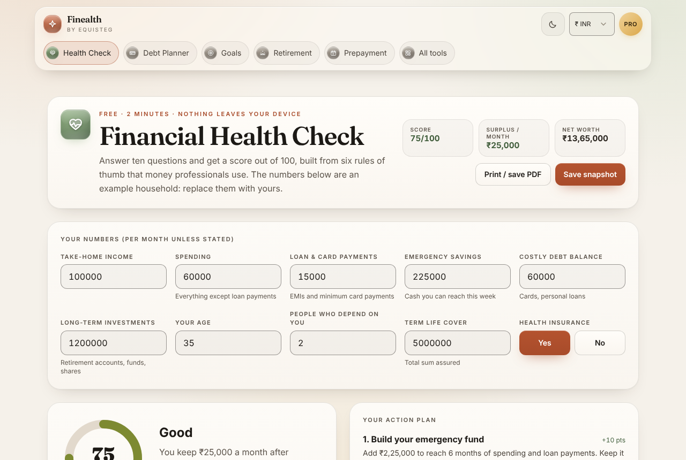

# 1. Workspace structure
```
finance-calculators/
├── apps/
│   ├── web/              @finealth/web      Next.js 16 static export (output: 'export', trailingSlash)
│   │   └── src/
│   │       ├── app/                  layout.tsx, page.tsx (home), not-found.tsx, robots.ts, sitemap.ts,
│   │       │                         globals.css, context/CurrencyContext.tsx
│   │       ├── app/(product)/        layout.tsx, template.tsx and the 17 product, calculator and legal pages,
│   │       │                         tools/page.tsx and tools/[slug]/page.tsx
│   │       ├── components/           ProProvider, PriceCards, ActivatePro, AdLoader, AdSenseBanner, ThemeToggle,
│   │       │                         GlassIcon, CalculatorShell, ui.tsx, site/ (header, footer, home), tools/ (planners)
│   │       └── lib/                  config, ads, pro, checkout, storage, usePersistent, theme, toolCatalog
│   ├── api/              @finealth/api      Cloudflare Worker (Hono): src/index.ts, routes/, lib/, config/skus.ts
│   └── mobile/           @finealth/mobile   Capacitor shell + its own Next.js export (android/, ios/)
├── packages/
│   ├── finance-core/     formulas, tax engines, plan limits, licence token (pure TypeScript, no DOM)
│   └── shared-types/     API and token types
├── tests/                automation/ (Robot Framework), web/ (Playwright), mobile/native (Appium), load/ (k6,
│                         Lighthouse), cases/, bugs/, testdata/, tools/
├── scripts/              test-cases.mjs, docs-export.mjs, manual-screenshots.mjs, gen-licence-keys.mjs,
│                         make-test-licence.mjs
└── docs/                 HLD, LLD, USER_MANUAL (+ .docx), manual/ screenshots, test-cases.md, standards/
```

# 2. Routes
All pages are static HTML (`out/<route>/index.html`). Planner and tool pages render on the client after hydration, inside `<main id="main">`. Product pages use `app/(product)/layout.tsx` (header, `ProNotice`, main, footer) and `template.tsx`, which fades a page in on client navigation but never on the first paint.

| Route | Component | Persists to storage | Key test ids |
|---|---|---|---|
| `/` | `app/page.tsx` + `components/site/HomeHero.tsx` | No | see §3.2 |
| `/health-check/` | `tools/HealthCheck.tsx` | `health`, `snapshots` | `in-income`, `in-expenses`, `in-debtpay`, `in-fund`, `in-costly`, `in-invest`, `in-age`, `health-result`, `health-score`, `health-grade`, `health-actions`, `health-pro-gate`, `health-pillars`, `print-report`, `save-snapshot` |
| `/debt-payoff/` | `tools/DebtPlanner.tsx` | `debts` (not the extra amount or strategy) | `add-debt`, `debt-limit`, `in-extra`, `debt-result`, `debt-free-in`, `debt-interest`, `debt-saved`, `debt-infeasible`, `debt-pro-gate`, `debt-whatif`, `in-whatif`, `whatif-result`, `export-debt-csv` |
| `/goal-planner/` | `tools/GoalPlanner.tsx` | `goals` (not the budget) | `goal-<i>`, `goal-<i>-result`, `goal-<i>-locked`, `add-goal`, `goal-limit`, `in-goal-budget`, `goals-needed`, `goals-surplus`, `export-goals-csv` |
| `/retirement-planner/` | `tools/RetirementPlanner.tsx` | `retirement` | `in-ret-saving`, `retirement-result`, `ret-corpus`, `ret-needed`, `ret-verdict`, `ret-pro-gate`, `ret-odds`, `run-odds`, `odds-success` |
| `/loan-prepayment/` | `tools/PrepaymentTool.tsx` | No | `in-outstanding`, `in-lump`, `prepay-tenure`, `tenure-saved`, `prepay-emi`, `emi-saved` |
| `/my-plan/` | `tools/MyPlan.tsx` | reads all, writes `snapshots` | `myplan-pro-gate`, `myplan-progress`, `myplan-latest`, `export-progress-csv`, `backup-download` |
| `/sip-calculator/`, `/emi-calculator/`, `/compound-interest/` | page + `CalculatorShell` (own currency chips) | No | sliders by label |
| `/tools/` | `(product)/tools/page.tsx` | No | `tools-disclaimer`, card test ids |
| `/tools/<slug>/` (36) | `tools/GenericTool.tsx` driven by `lib/toolCatalog.ts` | No | `in-<field key>`, `tool-result`, `tool-primary`, `tool-note`, `tool-source`, `tool-kpis` |
| `/pricing/` | page + `PriceCards.tsx` | `finealth.pro.v1`, `finealth.pending.v1` | `currency-toggle`, `pay-ack`, `pay-ack-box`, `price-yearly`, `price-lifetime`, buy buttons, `checkout-success`, `checkout-recover`, `checkout-error`, `licence-key-display`, `copy-key`, `price-compare` |
| `/pro/` | page + `ActivatePro.tsx` | `finealth.pro.v1` | `licence-key`, `activate-pro`, `activate-error`, `pending-confirm`, `pro-active`, `pro-renews`, `remove-pro` |
| `/about/`, `/privacy/`, `/terms/`, `/refund/`, `/contact/` | `site/LegalPage.tsx` pages | No | |
| `/robots.txt` | `app/robots.ts` | | disallows `/pro/` and `/my-plan/`; everything when `NEXT_PUBLIC_NOINDEX=1` |
| `/sitemap.xml` | `app/sitemap.ts` | | 16 routes + 36 tools; `/health-check/` priority 1, others 0.7 |
| 404 | `app/not-found.tsx` | | same header and footer, `noindex` |

## 2.1 The 36 catalog tools
`lib/toolCatalog.ts` holds one `ToolDef` per tool: `slug`, `title`, `summary`, `category`, `region`, optional fixed `currency`, `fields[]` (number, select, toggle or text, with a default and an optional INR default), `compute(values, fmt)` returning result rows and a note, `source`, optional `official` link, `limits` and `statutory`. `tools/[slug]/page.tsx` builds one static page per entry (`generateStaticParams`, `dynamicParams = false`) with its own title, description and canonical URL. Inputs are not saved. A `compute` that throws shows "Check the inputs".

| Category | Tools (slug) |
|---|---|
| Saving & investing (10) | `inflation-calculator`, `real-return-calculator`, `cagr-calculator`, `rule-of-72`, `simple-interest-calculator`, `recurring-deposit-calculator`, `savings-goal-calculator`, `retirement-corpus-calculator`, `ppf-calculator` (India), `xirr-calculator` |
| Borrowing (4) | `credit-card-payoff-calculator`, `loan-affordability-calculator`, `loan-true-cost-calculator`, `flat-rate-loan-calculator` |
| Housing (2) | `rent-vs-buy-calculator`, `uk-stamp-duty-calculator` (UK) |
| Tax & salary (9) | `india-tax-regime-calculator`, `hra-exemption-calculator`, `gratuity-calculator` (India); `us-federal-tax-calculator` (US); `australia-income-tax-calculator`, `canada-income-tax-calculator`, `singapore-income-tax-calculator`, `new-zealand-income-tax-calculator`; `salary-converter` |
| Everyday (6) | `budget-50-30-20-calculator`, `emergency-fund-calculator`, `net-worth-calculator`, `percentage-calculator`, `discount-calculator`, `tip-calculator` |
| Business (5) | `world-vat-gst-calculator`, `canada-sales-tax-calculator` (Canada), `npv-irr-calculator`, `margin-markup-calculator`, `break-even-calculator` |

Every tool page shows the result, then "How it is worked out" (the source), "Rates last checked: 9 November 2026" with the official link for statutory tools, "Not covered", and "Found a mistake? Tell us". The tools index heading counts 42 tools: the 36 catalog tools plus 6 planner cards (five planners and the regional calculators on the home page).

# 3. Web components
## 3.1 Site frame
| Component | Responsibility |
|---|---|
| `app/layout.tsx` | Fonts (Inter, Fraunces), metadata (title template `%s · Finealth`, publisher Equisteg, `noindex` when set), `THEME_BOOT` script in `<head>`, skip link, WebApplication JSON-LD with Equisteg as publisher, `ProProvider` → `AdLoader` → `CurrencyProvider` |
| `site/SiteHeader.tsx` | Sticky floating header. Logo ("Finealth by Equisteg"), `ThemeToggle`, Currency select (`aria-label="Currency"`: INR, USD, EUR, GBP), `go-pro` button or `pro-badge`, and the `NAV` tab rail: Health Check, Debt Planner, Goals, Retirement, Prepayment, All tools. The active tab gets `aria-current="page"` |
| `site/SiteFooter.tsx` | Logo, "A product by Equisteg" (link to equisteg.com), TEIQTools.com link, Product links (Health Check, Debt Planner, Goal Planner, Retirement Planner, All money tools, Pricing), Company links (About, Privacy, Terms, Refunds & cancellation, Contact, Restore Pro), general disclaimer |
| `ThemeToggle.tsx` | Flips light and dark, writes `finealth.theme`, syncs other tabs through the `storage` event |
| `app/context/CurrencyContext.tsx` | `baseCurrency` (default INR, held in memory only), US state (default TX), Indian city (default Mumbai), regional reference profiles for the home markets section, and a once-per-visit FX fetch whose rates are not used on screen (HLD §14) |
| `(product)/template.tsx` | Fade-in on client navigation only |

## 3.2 Home page (`site/HomeHero.tsx` and `app/page.tsx`)
| Section | Export | Test ids and content |
|---|---|---|
| Hero | `HomeHero` | `home-hero`; `hero-start` → `/health-check/`; `hero-tools` → `/tools/`; `hero-trust` (No login, no bank link · 36+ free calculators · Tax for 7 countries, VAT for N (N = entries in `WORLD_VAT_RATES`, 66 today) · Pro from ₹17 a month, or "Pro US$7.99 a year" outside INR); `hero-card` with `ScoreRing`, `hero-grade`, three stats and `hero-top-action`, all from `financialHealth(exampleHealth(currency))` |
| Proof strip | `ProofStrip` | `proof-strip`: 6 planners, `${TOOLS.length}+` calculators, 0 numbers sent, 2 min |
| Planners | `PlannerCards` | `planner-bento`: Health Check (large cell, six rule chips), Debt Payoff (Free · 3 debts), Goal Planner (Free · 1 goal), Loan Prepayment, Retirement (Free + Pro), My Plan (Free + Pro). Limits come from `FREE_LIMITS` |
| How it works | `HowItWorks` | `how-it-works`: type ten numbers, get your score, follow the plan |
| Markets | `app/page.tsx` | `markets`, `engine-badge` ("Reference values · not live"), City select (INR) or US state select (USD), `asset-card` ×n, history bars for the first two assets |
| Quick calculators | `app/page.tsx` | `quick-calcs`: a tab per regional tool. INR: EMI, SIP and step-up, income tax new vs old, GST split, FD and RD, CTC to in-hand. USD: mortgage PITI, 401(k) and Roth IRA, paycheck, sales tax. GBP: repayment mortgage, ISA, PAYE and NI, SDLT. EUR: Euribor mortgage, compound growth, VAT by country. Region defaults reset when the currency changes |
| Popular | `PopularTools` | `popular-tools`, `all-tools-link` ("All 36 tools →"): SIP, EMI, compound interest, then India regime, World VAT, XIRR, rent vs buy, 50/30/20, PPF |
| Free vs Pro | `FreeVsPro` | `free-vs-pro`, `plan-free`, `plan-pro`, `plan-pro-price`, `plans-pricing`; Pro list = `PRO_FEATURES` |
| Privacy | `PrivacyPromise` | `privacy-promise`: stays on this device; no bank link, no login; sourced rules, not advice |
| FAQ | `HomeFaq` | `home-faq`: five `<details>` items plus FAQPage JSON-LD |
| Final call | `FinalCta` | `final-cta` |
| Disclaimer | `app/page.tsx` | `disclaimer` |

## 3.3 Shared UI (`components/ui.tsx`)
| Export | Behaviour |
|---|---|
| `useMoney()` | Site currency (INR, USD, EUR, GBP) and a `formatMoney` bound to it |
| `ToolPage` | Heading card (icon, eyebrow, `h1`, intro, `tool-kpis` tiles, action buttons), children, `Disclaimer`, then the `calculator` ad slot |
| `Disclaimer` | `disclaimer` notice under every result: information only, not advice, may contain errors |
| `Panel` | Card section with an optional title and test id |
| `NumberField` | Labelled number input with hint, prefix, suffix, max and step; non-numbers become 0 |
| `Stat` | Label, value (test id on the value), tone (ok, warn, bad) and a sub-line |
| `ProGate` | For Pro: renders children. Otherwise a card with the feature, detail, "See Pro plans" and "I already have Pro". While the licence check runs, the same card is laid out invisible with `aria-busy`, so nothing shifts (CLS) |
| `ScoreRing` | 0-100 ring with `role="img"` and the number in `health-score` |
| `LineChart`, `Bar` | SVG line chart with an aria label; progress bar with tone |
| `useFitRows`, `FitArea` | Stretch the last item of each grid row so rows have no gaps |

## 3.4 Ads (`lib/ads.ts`, `AdLoader.tsx`, `AdSenseBanner.tsx`)
- `ADSENSE_CLIENT` defaults to `ca-pub-1503863859594756` (must match `public/ads.txt`). Slots `top`, `mid`, `bottom`, `calculator` come from `NEXT_PUBLIC_ADSENSE_SLOT_*`; unset means no ad.
- `useAdsAllowed()` is true only when the status is `free`, not `unconfirmed`, and no licence is stored.
- `AdLoader` injects `adsbygoogle.js` (`id="adsbygoogle-js"`, async, anonymous CORS) once ads are allowed.
- `AdSenseBanner` renders nothing for Pro, a `data-testid="ad-placeholder"` box on dev and staging when the slot is unset (`NEXT_PUBLIC_AD_PLACEHOLDERS=1` or development), and otherwise an `<ins class="adsbygoogle">` in a 100 px reserved box.
- **Consent:** there is no consent component in the code. EEA, UK and Switzerland consent must come from Google's certified message configured in AdSense (HLD §14, item 2).

## 3.5 Pro state (`ProProvider.tsx`)
`usePro()` returns `{ status, isPro, hasStored, activate, buy, remove, dismissNotice, pendingId }`. Status is `checking`, `free` (optional `notice`, optional `unconfirmed`) or `pro` (claims and plan). The provider resolves on load, again when the tab becomes visible, at token expiry, and every 60 s while unconfirmed. It also retries a pending checkout confirm on load. `ProNotice` shows "Couldn't confirm Pro — retrying." while unconfirmed, or the removal notice with an OK button. Outside the provider everything behaves as the free plan.

# 4. `@finealth/finance-core`
All functions are pure and synchronous. Bad numbers count as 0. Money in loops is integer minor units; results are rounded at the end (whole units, or 2 decimals for schedules). Number output is pinned to a locale per currency (`format.ts`: INR en-IN, USD en-US, EUR en-IE, GBP en-GB, AUD, CAD, NZD, SGD) so server HTML and the browser agree.

| Module | Main exports | Returns |
|---|---|---|
| `health.ts` | `financialHealth(input, fmt?)`, `gradeOf`, `retirementTargetMultiple`, `PILLAR_WEIGHTS`, `TARGETS` | score 0-100, grade, 6 pillars, ranked actions, metrics |
| `debt.ts` | `planDebtPayoff(debts, budget, strategy)`, `compareDebtStrategies(debts, budget)`, `orderDebts`, `MAX_MONTHS = 600` | feasibility, reason, months, interest, payoffs, schedule; minimum, avalanche, snowball, best, savings |
| `goals.ts` | `planGoal`, `planGoals(goals, budget)`, `monthlySavingFactor` | future cost, savings growth, gap, monthly needed; top-down allocation, funded share, surplus |
| `retirement.ts` | `projectRetirement`, `retirementOdds(input, runs = 1000, seed = 20261103)`, `seededRandom` | corpus at retirement, corpus needed, first-year spending, run-out age; success rate, p10/p50/p90, median run-out age |
| `prepayment.ts` | `comparePrepayment` | EMI, baseline, reduce-tenure and reduce-EMI options, `better` |
| `finance.ts` | `monthlyInstallment`, `loanSummary`, `mortgagePiti`, `sipFutureValue`, `lumpSumFutureValue`, `compoundGrowth`, `systematicWithdrawal`, `yearsToFinancialIndependence`, India regimes, `india80D`, `ctcToInHand`, `indiaHraExemption`, `indiaGratuity`, `gstBreakdown`, `consumptionTax`, `usPaycheck`, `ukTakeHome`, `stampDutyLandTax`, rate tables | statutory and regional calculators |
| `tools.ts` | 27 universal tool functions plus the `signChanges` and `parseIsoDate` helpers (§4.6) | catalog results |
| `world.ts` | `australiaTax`, `canadaTax`, `singaporeTax`, `newZealandTax`, `CA_SALES_TAX`, `WORLD_VAT_RATES`, `RATES_LAST_CHECKED` | country engines (§4.7) |
| `plan.ts` | `FREE_LIMITS`, `PRO_FEATURES`, `PLAN_PRICES`, `limitFor` | display limits and prices |
| `csv.ts` | `toCsv(header, rows)`, `csvCell` | RFC 4180 text with the formula guard |
| `licence.ts` | `signLicence`, `verifyLicence`, `verifyLicenceSignature`, `peekLicence`, `licenceKeyHash`, `envMatches`, `importSigningKey`, `importVerifyKey`, `TOKEN_TTL_SECONDS`, `TOKEN_REFRESH_SECONDS` | §7 |

## 4.1 Health score
Six pillars, each 0-100. The score is the weighted sum, with float noise trimmed, rounded to a whole number. Inputs per month: income, spending (without loan payments), loan and card payments, emergency savings, costly debt balance, investments, age, dependants, life cover, health cover (yes or no).

| Pillar | Measure | Full marks | Zero | Weight | Source |
|---|---|---|---|---|---|
| Savings rate | (income − spending − loan payments) / income | ≥ 20 % | ≤ 0 % | 20 % | 50/30/20 rule (Warren & Warren Tyagi, 2005) |
| Emergency fund | savings / (spending + loan payments) | ≥ 6 months | 0 | 20 % | CFPB emergency-fund guide (3-6 months) |
| Debt payments | loan payments / income | ≤ 10 % | ≥ 50 % | 20 % | CFPB debt-to-income (36 % warning, 43 % mortgage limit) |
| Costly debt | costly balance / yearly income | 0 | ≥ 50 % | 10 % | |
| Retirement savings | investments / yearly income vs the age target | ≥ target | 0 | 15 % | Fidelity: 1× at 30, 3× at 40, 6× at 50, 8× at 60, 10× at 67, linear between, 0 at 25 or younger (then full marks for any saving) |
| Insurance protection | 50 points for life cover (cover / yearly income vs 10×, or automatic when nobody depends on you) + 50 for health cover | 10× and yes | none | 15 % | Income-replacement rule (IRDAI consumer education) |

Pillar status: good ≥ 80, fair ≥ 50, else poor. Grades: ≥ 80 Excellent, ≥ 60 Good, ≥ 40 Fair, else Needs attention. Each action's points = (100 − pillar score) × weight; actions are sorted by points. Actions: clear costly debt first, build your emergency fund, raise your savings rate (or stop the monthly shortfall), lower your loan payments, catch up on retirement savings, close your insurance gaps.

Golden case: the INR example household (income ₹1,00,000, spending ₹60,000, loan payments ₹15,000, savings ₹2,25,000, costly debt ₹60,000, investments ₹12,00,000, age 35, 2 dependants, life cover ₹50,00,000, health cover yes) scores **75 / Good**, with top action "Build your emergency fund" worth +10 points. Other currencies use the same household divided by 20.

## 4.2 Debt payoff
Each month, for every open debt: interest = round(balance × APR / 1200) in minor units is added; the minimum (or the whole balance, if smaller) is paid; the rest of the budget goes to the first open debt in strategy order and rolls on when one clears. Avalanche = highest APR first (ties: smaller balance). Snowball = smallest balance first. Custom ("My order") = list order. Minimum = minimums only, no roll-over (the baseline).

Not feasible: "Your monthly budget is less than the total of the minimum payments."; "Your payments do not cover the interest, so the debt would keep growing."; "Not paid off within 50 years at this budget." (600 months). `compareDebtStrategies` picks snowball only when it is feasible and cheaper. Golden: ₹1,000 at 12 % paying ₹100 → 11 months, ₹58.98 interest.

The page budget = sum of the planned debts' minimums + "Extra on top of the minimums" (default 25 % of the minimums). The INR example (card ₹80,000 at 42 %, personal loan ₹2,50,000 at 14 %, phone EMI ₹30,000 at 16 %) gives a ₹19,375 budget and debt-free in 1 yr 10 mo with avalanche.

## 4.3 Goals
Future cost = cost × (1 + inflation)^years. Savings grow at (1 + r/12)^(12·years). Monthly saving = gap / F, with F = ((1 + i)^n − 1) / i × (1 + i) (annuity-due, i = r/12, n = 12·years), or a month-by-month sum with a yearly step-up. Rounded up so the goal is met. `planGoals` funds goals top-down from the budget: each gets min(left, needed); `funded` = allocated / needed; `surplus` = budget − total needed. Golden: ₹10 lakh in 10 years, 6 % inflation, 12 % return → future cost ₹17,90,848, ₹7,708 a month.

## 4.4 Retirement
Yearly model with money at the start of each year. Working years: corpus = (corpus + 12 × monthly saving) × (1 + r). Retired years: corpus = (corpus − spending) × (1 + r_retired); spending is inflated to the first retired year and grows with inflation. Corpus needed = present value at retirement of that spending stream to the plan-to age. On track = never runs out on expected returns.

Monte Carlo (Pro): each year's return ~ Normal(mean, volatility) using the mulberry32 seeded generator and Box-Muller; retired-year volatility is scaled by r_retired / r; a year cannot lose more than 95 %; runs are clamped to 1-10,000. The same inputs give the same answer. With volatility 0 the odds equal the straight-line verdict (unit test). The INR example (age 32, retire 60, plan to 85, ₹8 lakh saved, ₹25,000 a month, ₹7.2 lakh a year spending, 6 % inflation, 11 % and 7 % returns, 15 % volatility) runs out at 80 on expected returns and has a 23 % success rate.

## 4.5 Prepayment
EMI = P·r·(1 + r)^n / ((1 + r)^n − 1) (handles 0 %). Reduce tenure: keep the EMI (+ extra each month) on the reduced balance until zero. Reduce EMI: a new EMI over the same remaining months. Interest each month = round(balance × APR / 1200) in minor units. `better` = reduce tenure when it saves at least as much. Golden: ₹10 lakh, 9 %, 240 months, ₹1 lakh prepaid → EMI ₹8,997.26, new EMI ₹8,097.53, tenure 186 months (54 saved).

## 4.6 Universal tools (`tools.ts`)
| Tool | Formula | Source or golden |
|---|---|---|
| Inflation | FV = PV(1 + i)ⁿ; buying power = PV / (1 + i)ⁿ | ₹1,00,000 at 6 % for 10 y → ₹1,79,085 / ₹55,839 |
| Real return | (1 + n)/(1 + i) − 1 (Fisher) | 10 % and 6 % → 3.77 % |
| CAGR | (end/start)^(1/y) − 1 | 1 → 2 in 5 y → 14.87 % |
| Doubling | ln 2 / ln(1 + r); Rule of 72 = 72/r | 8 % → 9.01 y / 9 y |
| Simple interest | P·r·t | |
| RD | Σ P(1 + r/4)^(4(n − k + 1)/12), quarterly compounding (Indian bank method) | ₹5,000 × 12 at 7 % → ₹62,311 |
| PPF / yearly deposit | annuity-due, yearly compounding | ₹1.5 L × 15 y at 7.1 % → ₹40,68,209 |
| Savings target | gap / (((1 + i)ⁿ − 1)/i), i = r/12, after growing current savings | ₹10 L in 10 y at 12 % → ₹4,347 |
| Retirement corpus | Σ month k: E(1 + g)ᵏ / (1 + r)ᵏ with monthly equivalents of yearly rates | return = inflation → months × expense |
| NPV / IRR | Σ CFₜ/(1 + r)ᵗ; IRR by bisection on (−99.99 %, 10⁶ %); `signChanges` warns of multiple IRRs | −1000, 300, 400, 500 at 10 % → −21.04; IRR ≈ 8.9 % |
| XIRR | Σ CFᵢ/(1 + r)^(days/365) = 0 | +10 % over one year → 10 % |
| Card payoff | monthly interest at APR/12 before payment; capped at 600 months | 5,000 at 24 % paying 200 → 36 months, 2,001 interest |
| Affordability | max payment = income × limit − debts; loan = PMT(1 − (1 + r)⁻ⁿ)/r | 1,00,000, 50 %, 10,000, 9 %, 20 y → ₹44,45,798 |
| True loan rate | solve PV(payments) = principal − fees, × 12 | no fee → quoted rate |
| Flat rate | interest = P·r·t on the original amount; equivalent reducing rate solved | 1 L at 10 % flat, 3 y → EMI 3,611, ≈ 17.9 % reducing |
| Rent vs buy | month by month; the cheaper side invests the difference; buyer's wealth = home × (1 − selling costs) − loan + invested | ignores tax |
| 50/30/20, emergency fund, net worth, percentages, discount, margin and markup, break-even, salary breakdown, tip split | direct arithmetic | Emergency fund: 3-6 months of essential costs |

## 4.7 Country tax engines (`world.ts`, `finance.ts`)
Rates last checked **9 Nov 2026** (`RATES_LAST_CHECKED`, shown on every tax tool with a link to the official calculator).

| Engine | Rules | Golden |
|---|---|---|
| Australia 2026-27 | resident 0/15/30/37/45 % at 18,200/45,000/135,000/190,000; LITO $700 tapering; Medicare 2 % with shade-in over $27,222 | A$90,000 → tax $17,520, Medicare $1,800 |
| Canada 2026 | federal 14/20.5/26/29/33 % at 58,523/117,045/181,440/258,482; BPA 16,452 → 14,829; credits at 14 %; CPP 5.95 % (YMPE 74,600), CPP2 4 % to 85,000, EI 1.63 % to 68,900; provincial = flat estimate | C$60,000 → federal $5,338, CPP $3,362, EI $978 |
| Singapore (YA 2025 on) | resident 0-24 %; CPF employee 20 % to the S$8,000 monthly ceiling; earned income relief S$1,000 | S$60,000 → tax $1,040 |
| New Zealand | 10.5/17.5/30/33/39 % at 15,600/53,500/78,100/180,000; ACC levy editable | NZ$80,000 → $16,278 |
| US 2026 | single and married joint brackets (Rev. Proc. 2025-32), standard deduction 32,200 joint, FICA, Additional Medicare | $150,000 joint → $15,340; $80,000 single → $8,770 |
| India | new regime with 87A marginal relief and surcharge relief; old regime with age bands (₹2.5 L / 3 L / 5 L), 80C cap ₹1.5 L, 80D caps for self and parents (₹25k, ₹50k if 60+), HRA least of three, gratuity wage × 15/26 × years (cap ₹20 L) | ₹13 L new → ₹26,000; ₹15 L old with 80D 40k + 60k → ₹1,87,200 |
| UK | 2026/27 PAYE and NI; SDLT for home movers, first-time buyers and additional property, + 2 % non-resident | £60,000 → tax £11,432, NI £3,211 |
| VAT / GST | 66 countries: 27 EU states + 39 others (Pakistan deliberately excluded); India GST slabs; Canada GST/HST/PST by province | DE 119 incl. → 19.00 VAT |

# 5. Free vs Pro gating
| Feature | Free | Pro |
|---|---|---|
| Health check | Score, grade, three stats, top action, count of more actions | All actions, six-pillar breakdown, Print / save PDF, Save snapshot |
| Debt planner | First 3 debts planned, result, strategy comparison, payoff order | Unlimited debts, What if I paid more?, balance chart, schedule, Export CSV |
| Goal planner | First goal planned | Every goal, priority order (↑ ↓), yearly step-up, Export CSV |
| Retirement | Straight-line projection | 1,000-run odds with bad, typical and good outcomes |
| My Plan | Backup, restore, delete | Progress chart, latest score, change, Export CSV |
| Prepayment, calculators | Yes | Yes |
| Ads | Yes (when slots are set) | None; script never loaded |

`limitFor(key, isPro)` returns `FREE_LIMITS[key]` or `Infinity`. Saved rows above the free limit stay in storage, show faded or locked ("Saved, but not planned on the free plan. It comes back with Pro."), are left out of the maths and come back with Pro.

# 6. Storage
`lib/storage.ts` reads and writes JSON under `finealth.v1.<key>`. Every read is validated and falls back to the example. Write failures (private mode, quota) are ignored, so the page keeps working for the visit. `usePersistent` reads after mount (no hydration mismatch) and saves on every change after the first. A stored `null` means "show the example".

| Key | Shape | Validator |
|---|---|---|
| `finealth.v1.health` | `HealthInput` (9 finite numbers + `hasHealthCover` boolean) | `isHealthInput` |
| `finealth.v1.debts` | `Debt[]` ≤ 50: `id`, `name` (≤ 80), `balance`, `aprPct`, `minPayment` | `isDebtList` |
| `finealth.v1.goals` | `Goal[]` ≤ 50: `id`, `name`, `costToday`, `years`, `inflationPct`, `returnPct`, `currentSavings`, optional `stepUpPct` | `isGoalList` |
| `finealth.v1.retirement` | `RetirementInput` (10 finite numbers) | `isRetirementInput` |
| `finealth.v1.snapshots` | `Snapshot[]` ≤ 500: `at` (ISO), `score`, `pillars` (id → score), `currency`, `netWorth` | `isSnapshotList` |
| `finealth.pro.v1` | `{ key, plan, token, lastSeen }` | `readStoredPro` (key pattern, web plan, token ≤ 2,000 chars) |
| `finealth.pending.v1` | Razorpay ids of a paid checkout awaiting confirm | `readPending` |
| `finealth.theme` | `'light'` or `'dark'` | `THEME_BOOT` ignores anything else |

**Backup file** `finealth-backup-YYYY-MM-DD.json`: `{ app: 'finealth', version: 1, exportedAt, data: { health?, debts?, goals?, retirement?, snapshots? } }`. Import rejects files over 2 MB, non-JSON, or a wrong `app` or `version`, writes only the sections that validate, and reports which were restored. Delete my data removes the five `finealth.v1.*` keys; the licence and theme stay.

**CSV files:** `finealth-debt-plan.csv` (Month, Paid, Interest, Balance left), `finealth-goals.csv` (Priority, Goal, Cost today, Years, Future cost, Monthly needed, Allocated), `finealth-progress.csv` (Date, Score, Net worth, Currency and the six pillar scores).

**Not stored:** the currency choice, the debt extra amount and strategy, the goal budget, prepayment inputs, calculator and tool inputs.

# 7. Licence token
**Format:** `base64url(JSON claims) + "." + base64url(Ed25519 signature over the first part)`, at most 2,000 characters.

| Claim | Meaning |
|---|---|
| `v` | 1 |
| `plan` | `pro_monthly`, `pro_yearly` or `pro_lifetime` |
| `src` | `razorpay` or `play` |
| `iat`, `exp` | seconds; `exp` = min(now + 7 days, store expiry) |
| `kh` | Razorpay only: first 16 bytes of SHA-256(licence key), base64url (22 chars). Not reversible |
| `env` | `dev`, `staging` or `production` of the issuing Worker |

**Keys:** the private key is the Worker secret `LICENCE_SIGNING_KEY` (PKCS#8, base64url). The public key is `NEXT_PUBLIC_LICENCE_PUBLIC_KEY` (raw 32 bytes, base64url). The Worker derives its own verifier from the private key for refresh proofs. Generate a pair with `npm run licence:keys`.

**Client verification (`lib/pro.ts`):** the signature verifies, the claims have the right shape, `exp` > now, `env` matches `NEXT_PUBLIC_ENV` (when both are known), and the plan is a web plan. Fresh when more than 2 days are left; otherwise refresh with `{ key, token }`. Clock rollback: if now is more than an hour before `lastSeen`, or more than 5 minutes before `iat`, the token is not trusted offline. `peekLicence` reads claims without checking and is only used for display.

**Refresh proof (Worker):** a token counts as proof when its signature is ours, `src` is razorpay, `env` matches, `kh` equals the hash of the key (or its canonical `sub_` key), and `iat` is within 30 days. Otherwise the request counts as a new activation.

# 8. Worker API (`apps/api`)
Static files are served by Workers Static Assets before the Worker runs (`run_worker_first: ["/api/*"]`, `not_found_handling: "404-page"`). Middleware on `/api/*`, in order: request id (echo a sane `x-request-id` or create one, then one log line), `canonicalHost` (production: 301 to `CANONICAL_HOST`), `securityHeaders`, `cors` (allow-list: same origin, `https://<CANONICAL_HOST>`, `ALLOWED_ORIGINS`, `finealth://app`, and localhost outside production; no credentials), body limit 16 KB (4 KB on errors), `mutationGuard` (foreign Origin → 403, non-JSON POST → 415), rate limits (strict 5/min per IP on licence, play, checkout and confirm; 120/min on the rest).

**Response headers on `/api/*`:** `cache-control: no-store`, `x-content-type-options: nosniff`, `x-frame-options: DENY`, `referrer-policy: no-referrer`, `content-security-policy: default-src 'none'; frame-ancestors 'none'`, `strict-transport-security: max-age=31536000; includeSubDomains`, `permissions-policy: interest-cohort=()`. Static pages get theirs from `apps/web/public/_headers` (served by Workers Static Assets): HSTS, `nosniff`, `X-Frame-Options: DENY`, `strict-origin-when-cross-origin` referrer and a permissions policy turning off camera, microphone, geolocation and USB. A page CSP is still open (RSK-015).

| Route | Body | Success | Notes |
|---|---|---|---|
| `GET /api/v1/health` | | `{ ok, release, env, checks: { signingKey, razorpay } }` | `ok` / `missing` per check |
| `POST /api/v1/checkout` | `{ plan: pro_yearly \| pro_lifetime, currency: INR \| USD }` | `{ provider: 'razorpay', keyId, plan, currency, amount, orderId \| subscriptionId, name, description }` | Kill switch `checkout` → 503. Lifetime: order at `SKUS` price, random receipt `fh-…`. Yearly: subscription on the INR or USD plan, 10 cycles, `customer_notify`. Missing USD plan → 503 "International payments are not enabled yet." Notes `{ product: 'finealth', plan }` |
| `POST /api/v1/checkout/confirm` | `razorpay_payment_id`, `razorpay_signature`, exactly one of `razorpay_order_id` / `razorpay_subscription_id` | `{ token, key, plan }` | HMAC-SHA256 of `order_id|payment_id` or `payment_id|subscription_id`. Captures an `authorized` lifetime payment of our own order. Counts activation once per payment (`fh_confirmed`) |
| `POST /api/v1/licence/verify` | `{ key, activate?: boolean, token?: string }` | `{ token }` or `{ token, key }` when a subscription charge's `pay_` resolves to its `sub_` | `activate: true` counts; a refresh with a valid proof does not. Plan always comes from Razorpay |
| `POST /api/v1/play/verify` | `{ purchaseToken, productId, kind: subscription \| product }` | `{ token }` | Subscriptions v2: ACTIVE, IN_GRACE_PERIOD or CANCELED with a future expiry → token to expiry; PENDING → 409; 410 → expired. Products: state 0 → lifetime token; 1 or refunded → 403; 2 → 409 |
| `POST /api/v1/errors` | `{ platform: web \| android \| ios, message, stack?, release?, route? }` | 204 | Scrubbed again and logged with a fingerprint. No client calls it yet |
| other `/api/*` | | 404 `not_found` | |

**Razorpay checks in `resolveRazorpayKey`:** a `pay_` key must belong to an order with our notes, plan `pro_lifetime`, matching amount and currency, status paid or attempted, payment captured and not refunded (any refund ends Pro). A `pay_` from a subscription invoice resolves to its subscription. A `sub_` key must carry our notes and a current or legacy yearly plan id; `active` or `pending` → expiry = `current_end` + 3 days grace; `created` or `authenticated` → 409 pending; `cancelled` → Pro until the paid period ends; anything else → 403 expired. The latest paid invoice payment is checked for refunds. Activations: `notes.fh_activations` +1 up to `MAX_ACTIVATIONS` (5); a failed write still grants (RSK-007).

**Error body:** `{ error: { code, message } }`, with `retry-after: 60` on 429.

| Code | Status | Meaning |
|---|---|---|
| `invalid_request` | 400 | Bad JSON or fields |
| `invalid_key` | 400 | Any bad, unknown or foreign key (one message for all) |
| `invalid_payment` | 400 | Bad Checkout signature or ids |
| `refunded` | 403 | Purchase refunded |
| `expired` | 403 | Subscription ended |
| `too_many_activations` | 403 | Over the browser limit |
| `forbidden_origin` | 403 | Foreign Origin |
| `pending` | 409 | Payment still processing |
| `payload_too_large` | 413 | Body over the limit |
| `unsupported_media_type` | 415 | Not JSON |
| `rate_limited` | 429 | Over the rate limit |
| `internal` | 500 | Unexpected error (logged scrubbed) |
| `unavailable` | 503 | Signing key or store config missing, store unreachable, kill switch |

**Logging (`lib/scrub.ts`):** one JSON line per request. `scrub()` removes emails, bearer tokens, JWT-like tokens, query strings, Razorpay ids, dash-grouped keys, tax ids, long tokens and any number with 6 or more digits. Keys appear only as `keyRef` (first 4 bytes of SHA-256, hex).

# 9. Configuration
| What | Where | Value |
|---|---|---|
| Display prices | `packages/finance-core/src/plan.ts` `PLAN_PRICES` | Monthly ₹29 / US$0.99 (Android only), Yearly ₹199 / US$7.99, Lifetime ₹499 / US$19.99 |
| Charged web prices | `apps/api/src/config/skus.ts` `SKUS` (minor units) | Lifetime INR 49900 / USD 1999; Yearly INR 19900 / USD 799 (the Razorpay plan does the yearly charge) |
| Free limits | `plan.ts` `FREE_LIMITS` | debts 3, goals 1, health actions 1, snapshots 0 |
| Token lifetime | `licence.ts` | 7 days; refresh under 2 days |
| Renewal grace | `skus.ts` `RENEWAL_GRACE_SECONDS` | 3 days |
| Yearly cycles | `skus.ts` `YEARLY_TOTAL_COUNT` | 10 |
| Activations | Worker `MAX_ACTIVATIONS` | 5 |
| Play products | Worker vars | package `com.tezech.finealth`, subscription `pro` (base plans `monthly`, `yearly`), product `pro_lifetime` |
| Production host | `lib/config.ts` `PRODUCTION_HOST`, Worker `CANONICAL_HOST` | `finealth.teiqtools.com` |

`plan.ts` and `skus.ts` agree today. A price change means: a new Razorpay plan (never edit an old one), its id in `RAZORPAY_PLAN_ID_YEARLY_*`, the old id added to `RAZORPAY_PLAN_IDS_YEARLY_LEGACY`, `skus.ts`, `plan.ts` and Play Console updated together.

# 10. Error states shown to people
| Where | Message | Cause |
|---|---|---|
| Debt planner | "Your monthly budget is less than the total of the minimum payments." | budget < minimums |
| Debt planner | "Your payments do not cover the interest, so the debt would keep growing." | payment ≤ interest |
| Debt planner | "Not paid off within 50 years at this budget." | over 600 months |
| Goal planner | "Shortfall" tile and "Push a goal out a few years, lower its cost, or raise the budget to close the gap." | budget < needed |
| Tool pages | "Check the inputs" | `compute` threw |
| My Plan | "That file is too large to be a Finealth backup." / "That file is not a Finealth backup (it is not valid JSON)." / "That file is not a Finealth backup." / "The backup had nothing we could restore." | import checks |
| Restore Pro | "That ID was not recognised. Paste the payment ID (pay_…) or subscription ID (sub_…) from your Razorpay receipt." | `invalid_key` |
| Restore Pro / notice | "This purchase was refunded, so Pro is no longer active on this browser." | `refunded` |
| Restore Pro / notice | "This subscription has ended. Buy Pro again on the pricing page to keep Pro." | `expired` |
| Restore Pro | "This licence key has been activated on too many browsers. Contact support to reset it." | `too_many_activations` |
| Restore Pro | "This payment is still processing. Please try again in a few minutes." | `pending` |
| Restore Pro | "Too many attempts. Please wait a minute and try again." | `rate_limited` |
| Restore Pro | "The licence check is unavailable right now. Please try again shortly." / "Could not reach the licence check. Check your connection and try again." | 503 / network |
| Restore Pro | "Pro activation is not switched on for this site yet." | no public key in the build |
| Any page | "Couldn't confirm Pro — retrying." | stored licence, temporary failure |
| Pricing | "Coming soon" on the buy buttons | `NEXT_PUBLIC_RAZORPAY_ENABLED` not `1` |
| Pricing | "Buying Pro is paused for a short while. Please try again later." | kill switch |
| Pricing | "Your payment went through, but we could not switch Pro on just now. Open the Restore Pro page and paste this ID to finish. Nothing is lost." | paid, confirm failed |

# 11. Testing
## 11.1 Test cases
- **Workbook:** `tests/cases/test-cases.xlsx`, ClearFile format (10 Nov 2026). Sheets: *Read me*, *Test Cases*, *Summary* (counts by formula) and *Archive* (the 123 cases of the older sheet with their old ids).
- **Source of truth:** `tests/cases/fragments/<feature>.json` (one file per feature) and `tests/cases/archive.json`. Never edit the workbook by hand.
- **Build:** `npm run cases` runs `scripts/test-cases.mjs` (validates and writes the workbook) and then `python tests/tools/export_cases.py --check` (every REQ and NFR in `docs/product-brief.md` has cases, every case names a Robot test that exists) and writes `docs/test-cases.md`.
- **Columns (19):** TC ID, Feature, Platform (Web, Android, API), Test Type (Functional, Non-functional), Scenario (Positive, Negative, Edge, Performance, Load, Security, Accessibility, Compatibility, Reliability, Compliance, Privacy, SEO, Accuracy), Test Case Description, REQ / NFR, Priority (P1-P3), Sanity, Regression, Integration (Y or N), Preconditions, Test Data, Steps, Expected Result, Automatable, Automation Script, Status (Not run, Pass, Fail, Flaky, Blocked, Retired), Remarks / old TC ID.
- **Rules:** numbered Steps with the same number of numbered Expected Results; ids `TC-W-…` (web), `TC-M-…` (Android), `TC-A-…` (API), `TC-N-…` (non-functional), never reused; Automation Script = `tests/automation/<platform>/<feature>/<file>.robot :: <TC ID>`; Playwright and unit twins go in Remarks; non-functional results state a measurable threshold.

## 11.2 Robot Framework automation (`tests/automation`)
Python, Robot Framework and SeleniumLibrary (packages pinned in `requirements.txt`). One Robot test per TC ID, named `<TC ID> <title>` and tagged with its suites and priority.

**Layout:** `run.py`; `libraries/` (`FinealthLib.py`, `WebSiteLib.py`, `WebToolsLib.py`, `NonfunctionalLib.py`, `ApiAndroidLib.py`, `LiveProgress.py`, `engine-bridge.mjs`, `api-bridge.mjs`, `bundle.mjs`); `resources/` (`common.resource` and feature resources for planners, site, tools, non-functional and API/Android); suites under `web/<feature>/` (home, health, debt, myplan, pricing, pro, tools, calc, ads, legal, seo, nav, nfr and more), `mobile/<feature>/` (app, calculators, navigation, offline) and `api/<feature>/` (licence, play, checkout, confirm, errors, health, security).

**`run.py` options:**

| Option | Effect |
|---|---|
| `--suite sanity \| regression \| integration \| all` | flagged set (default all) |
| `--platform web \| android \| api \| all` | platform folder |
| `--feature <folder>` | one feature folder |
| `--test TC-…,TC-…` | chosen test cases |
| `--exclude <tag>` | leave out a tag |
| `--env local \| staging \| dev` | target (default `FH_TEST_ENV` or local) |
| `--base-url`, `--mobile-url`, `--pro-url` | addresses; only local, `*-dev.*.workers.dev` or `*-staging.*.workers.dev` are allowed, never production |
| `--serve` | start static servers for the builds that exist: web :3100, app :3101, Pro :3102 |
| `--browser chrome \| firefox \| edge` | browser |
| `--headless` | no window (CI) |
| `--slow <seconds>` | pause after each browser action |
| `--dryrun` | check every suite without running |
| `--log-bugs` | after the run, add failures to `tests/bugs/bug-log.xlsx` and statuses to the workbook |
| `--no-open` | do not open the report |

Shortcuts: `npm run robot` (everything, local, `--serve`), `npm run robot:dryrun`, `npm run robot:pro-site`.

**`resources/common.resource` keywords:** Open Finealth, Open Finealth Pro, Open Finealth App, Close Finealth, Go To Page, Wait For Page Rendered, Evidence, Capture Failure Evidence, Test Id, Text Of, Test Id Should Contain, Test Id Text Should Be, Heading Should Contain, Click Button Named, Main Text Should Contain, Main Text Should Not Match, Disclaimer Should Be Visible, Page Should Have No Console Problems, Page Should Load No Ad Script, Page Should Pass Axe, Number Of Test Id Should Be.

**`libraries/FinealthLib.py` keywords:** Open Browser (phone size, dark mode, reduced motion), Set Width, Set Field (by label, aria-label or test id, typed like a person), Set Range, Field Value, Get Field Value, Click Centered, Set Storage, Get Storage, Storage Keys, Clear Storage, Seed Pro, Tamper Pro, Console Problems, Network Requests, No Request Carries, No Hscroll, Elements Fit, Layout Shift, Run Axe, Computed Style, Contrast, Number From, Wait For Download, Now, Read Csv, Read Raw, Read Json, Write Json, Clear Folder, Fetch Text, Call Engine, Call API.

**Bridges:** `engine-bridge.mjs` runs one `finance-core` function (`Call Engine`) so money checks compare the screen with the engine, not with numbers copied by hand. `api-bridge.mjs` runs the Worker in-process (`Call API`) with scripted fakes of Razorpay and Google chosen by a named scenario, a throwaway Ed25519 key and a throwaway service account; nothing real is called and no real secret is read. Body placeholders such as `$SIG`, `$OUR_TOKEN` and `$FORGED_TOKEN` are filled per run. `bundle.mjs` builds both with esbuild into `.cache/`.

**Pro test build:** `tools/build-pro-site.mjs` creates a throwaway Ed25519 key in memory, builds the site trusting it into `tests/automation/.pro-site/`, writes a 6-day token to `.pro-site.token`, then rebuilds the normal site. The key is never saved. Pro cases skip when no token exists, and on staging.

**Evidence:** each run writes `tests/automation/results/<date-time>_<pid>/` with `report.html` (totals and status per suite and tag), `log.html` (every step with timings and a screenshot of each key screen and of any failure), `output.xml` (used by `--log-bugs`, CI and `tests/tools/collect-results.mjs`) and `downloads/` (checked backup and CSV files).

**Bug log:** `tests/tools/bug_log.py` (`init`, `ingest <summary.json> [--report …]`, `list [open|all]`, `set BUG-n "Field=value"`). Ingest adds a Runs row, logs each failed or flaky result as a new, updated or reopened bug, marks fixed bugs Verified when their test passes on staging, and writes Pass, Fail or Flaky into the workbook's Status column. Reports go to `docs/test-reports/`.

## 11.3 Other test layers
| Layer | Where | Run |
|---|---|---|
| Engine golden tests (Vitest) | `packages/finance-core/src/*.test.ts`: finance, planning, tools, world, licence | `npm test` |
| Web unit tests (Vitest) | `apps/web/src/lib/*.test.ts` (storage, pro, checkout, theme, toolCatalog), `apps/web/__tests__/HomePage.test.tsx` | `npm test` |
| Mobile unit tests | `apps/mobile/__tests__/HomePage.test.tsx` | `npm test` |
| Worker API tests | `apps/api/test/api.test.ts` (faked Razorpay and Play) | `npm test` |
| Playwright | `tests/web/specs/`: `finealth-web`, `product`, `pro`, `a11y`, `finealth-mobile` specs; projects `web` and `mobile-webview`; local static servers via `tests/web/scripts/serve-static.mjs` | `npm run test:web` |
| Appium (real device) | `tests/mobile/native/finealth-native.appium.spec.ts`: status-bar inset, haptics, airplane mode | manual, device |
| k6 load | `tests/load/load.js`, profiles smoke, load, stress, spike, soak; limits in `tests/testdata/shared/load.json` (p95 < 300 ms per NFR-012, errors < 1 %); 429 counts as expected | `tests/tools/perf.mjs`, staging only |
| Lighthouse CI | `tests/load/lighthouserc.json`: 7 pages × 3 runs, performance, accessibility and best practices ≥ 0.9 | CI or `tests/tools/perf.mjs` |
| Security | Gitleaks (tree and built bundle), Semgrep CE, OSV-Scanner, forbidden-files check | `.github/workflows/ci.yml`, `npm run security` |
| Whole repo | lint, typecheck, test, build across workspaces | `npm run check` |

CLAUDE.md names `npm run perf` and `npm run load`, but the root `package.json` has no such scripts yet; run `node tests/tools/perf.mjs` directly.

## 11.4 Screenshots for the manual
`npm run docs:shots` runs `scripts/manual-screenshots.mjs`. It opens the local builds (web :3100, app :3101, Pro :3102) or a dev or staging Worker, blocks the FX call and ad hosts, and writes the 28 pictures in `docs/manual/`. Every number is the built-in example household. The Pro pictures use the throwaway test key.



# 12. Accessibility
Every input has a visible label. Result values have test ids and text. The score ring has `role="img"` and an aria label. Toggles use `aria-pressed`. Colour is never the only signal. The skip link jumps to `main#main`. `ProGate` keeps its height while checking (CLS < 0.1). The disclaimer uses normal text size and AA contrast in both modes. Charts carry aria labels and the market history bars have screen-reader text.
