# 1. What Finealth does
Finealth tells you how healthy your money is and what to do next. You type in about ten numbers you already know. Finealth gives you a score out of 100, the one change that lifts it most, and plans for your debts, goals, retirement and home loan. It also has 36 free calculators for tax, loans, savings and everyday sums.

- **No sign-up.** There is no account, no login and no bank link.
- **Private.** Everything you type stays in your browser on this device. Finealth's server never sees your numbers.
- **Free to use.** The calculators and the main planners are free. Pro is optional (see section 12).

Finealth gives information and estimates, not financial advice. It never tells you which product to buy. Check important decisions with the official source or a qualified professional.

The website is at **finealth.teiqtools.com**. It works in any modern browser on a computer, tablet or phone. The pictures in this manual show the built-in example household, not a real person.

# 2. Finding your way around
## 2.1 The top bar
Every page has the same bar at the top.

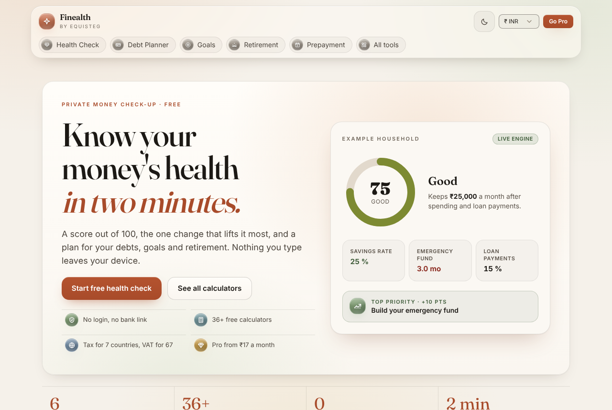

| Part | What it does |
|---|---|
| **Finealth** logo | Goes back to the home page |
| Moon or sun button | Switches between light and dark mode (section 2.2) |
| **Currency** menu (₹ INR, $ USD, € EUR, £ GBP) | Changes the currency symbol and number style, the example numbers, and the regional calculators on the home page |
| **Go Pro** button | Opens Pricing. When Pro is active it becomes a gold **Pro** badge that opens your Pro page |
| Tabs: Health Check, Debt Planner, Goals, Retirement, Prepayment, All tools | Open each part of Finealth. The tab you are on is highlighted |

On a narrow screen the tabs slide sideways. Swipe the row to see the rest.

**About the currency menu.** Changing the currency does not convert numbers you have already typed. If you saved ₹85,000 as your income and switch to $, the planner shows $85,000. Pick your currency first, then type your numbers. Finealth starts in ₹ INR each time you open it, so choose your currency again if you use another one.

At the bottom of every page you find links to all planners, Pricing, About, Privacy, Terms, Refunds & cancellation, Contact and **Restore Pro**, and the line "A product by Equisteg".

## 2.2 Light and dark mode
Finealth follows your device's light or dark setting. Press the moon (or sun) button to choose a mode yourself. Finealth remembers your choice in this browser.

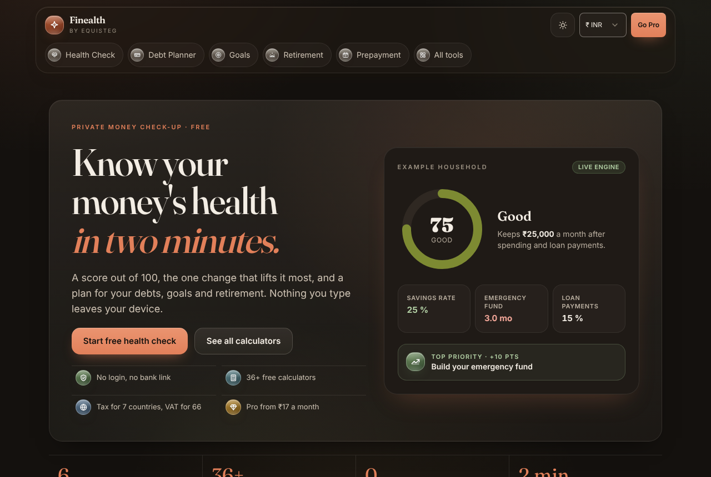

## 2.3 On a phone
Everything works on a phone. Cards stack in one column and the tabs scroll sideways.

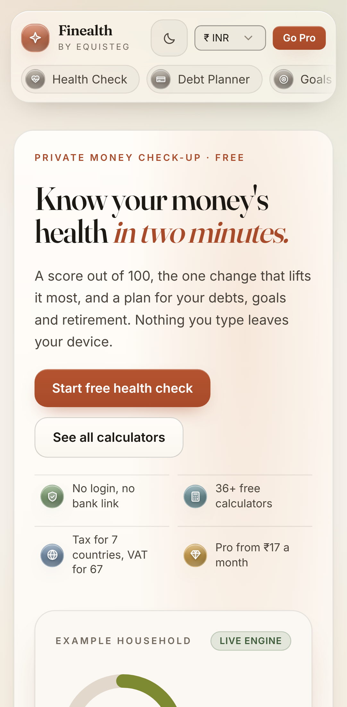

# 3. The home page
The home page explains Finealth and leads you to the right tool. From top to bottom:

1. **Know your money's health in two minutes.** Press **Start free health check** to begin, or **See all calculators**. The card on the right is a live example: the same engine scores an example household (75, Good) and shows its top priority.
2. **Finealth in numbers:** 6 planners, 36+ calculators, 0 numbers sent to a server, 2 minutes to your first score.
3. **Six planners, one calm picture.** One card per planner. Each card says whether it is free, and the free limit.
4. **How it works:** type ten numbers, get your score, follow the plan.
5. **Markets at a glance** (section 3.2).
6. **Quick calculators** for your currency's country (section 11.4).
7. **The ones people use most:** shortcuts to the SIP, EMI and compound-interest calculators and six popular tools.
8. **Free to start, Pro when you plan:** the free and Pro plans side by side.
9. **Your money stays yours:** the privacy promise.
10. **Before you start:** five common questions.
11. A last **Start free health check** button and the disclaimer.

## 3.1 The planner cards
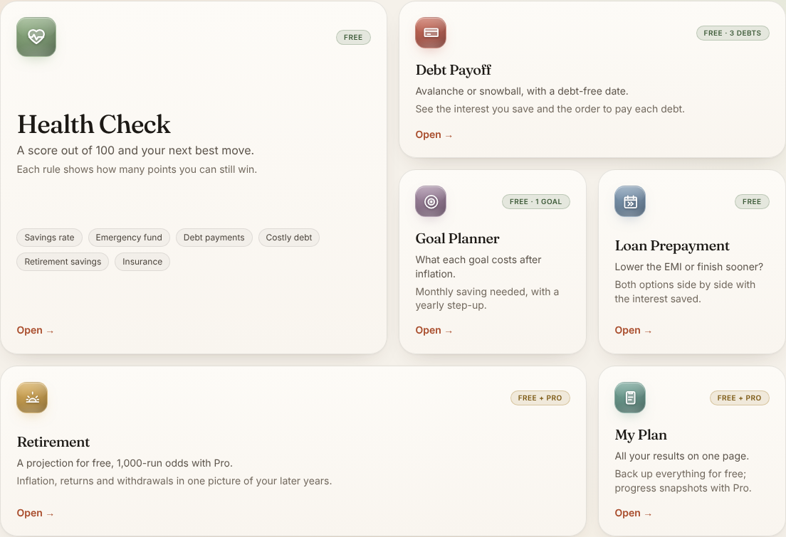

Press **Open →** on a card to go to that planner. The tags mean: **Free** (everything free), **Free · 3 debts** or **Free · 1 goal** (free up to that limit), **Free + Pro** (the basics are free, extras need Pro).

## 3.2 Markets at a glance
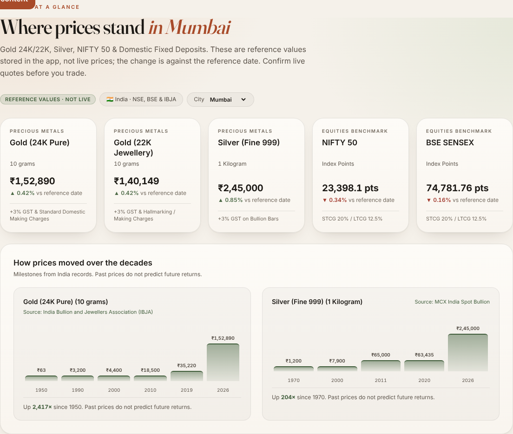

This section shows reference prices for your currency's country: for India, gold 24K and 22K, silver, NIFTY 50 and BSE SENSEX. With ₹ INR you can pick a **City**, which adds the local gold and silver premium. With $ USD you can pick a **State**.

These are **reference values stored in the app, not live prices.** The green or red percentage is the change against the reference date. The bar charts show how prices moved over the decades, with the source. Past prices do not predict future returns. Check live quotes before you buy or sell anything.

## 3.3 Free and Pro, questions
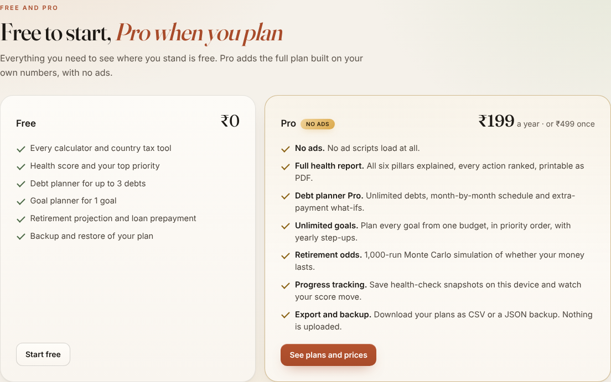

The prices shown follow your currency: ₹199 a year or ₹499 once in India, US$7.99 a year or US$19.99 once elsewhere. Press **See plans and prices** for the Pricing page.

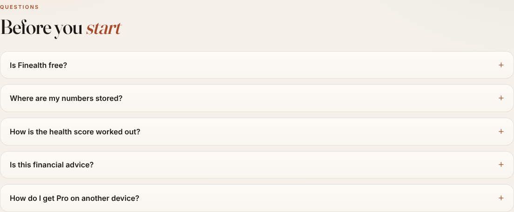

Press a question to open its answer. Press it again to close it.

# 4. Financial Health Check
The health check gives you a score out of 100 from six rules of thumb that money professionals use.

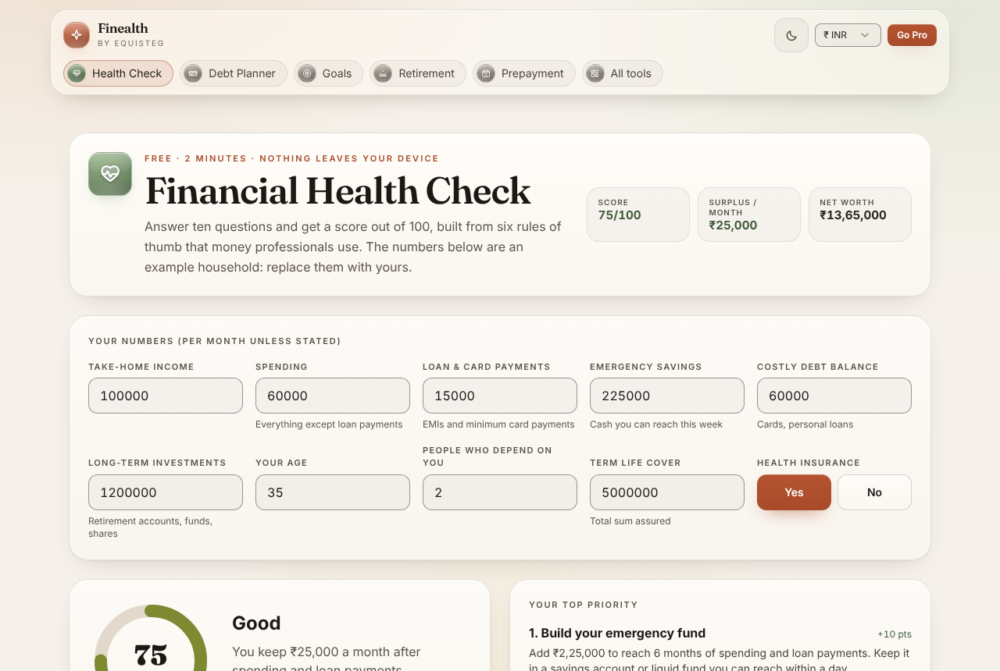

## 4.1 What to enter
The first time, the form holds an example household. Replace each number with yours. The score updates as you type, and your numbers are saved in this browser straight away. All amounts are **per month** unless the field says otherwise.

| Field | What to put |
|---|---|
| Take-home income | What reaches your bank account each month, after tax |
| Spending | Everything you spend in a month, except loan and card payments |
| Loan & card payments | All your EMIs plus the minimum payments on your cards |
| Emergency savings | Cash you could use this week: savings account, liquid fund |
| Costly debt balance | What you still owe on credit cards and personal loans (the total, not the monthly payment) |
| Long-term investments | Retirement accounts and investments: EPF, PPF, NPS, 401(k), ISA, funds, shares |
| Your age | Used for the retirement-savings rule |
| People who depend on you | Children, a partner or parents who rely on your income. Used for the life-cover rule |
| Term life cover | Your total sum assured |
| Health insurance | Press **Yes** if you have an active health policy, **No** if not |

**Reset to the example** appears once you have changed a number. It brings back the example household.

## 4.2 Reading your result
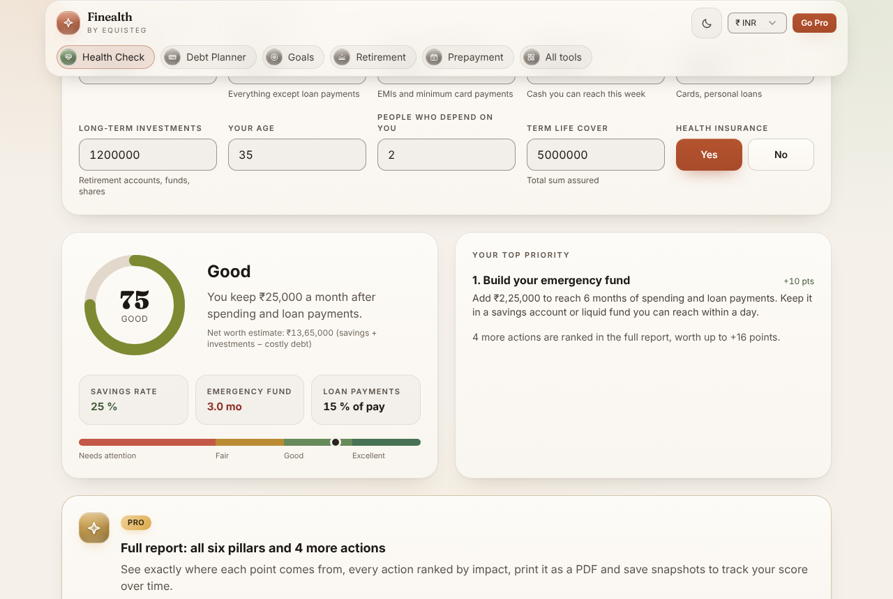

- **The ring** shows your score out of 100 and your grade: **80-100 Excellent, 60-79 Good, 40-59 Fair, below 40 Needs attention.** The coloured bar under it shows where you sit on that scale.
- **You keep … a month** is your income minus spending and loan payments. If it is negative, it says how much you are short each month.
- **Net worth estimate** is emergency savings + investments − costly debt. It leaves out your home and other loans.
- **Savings rate** is the share of income you keep. 20 % or more is green.
- **Emergency fund** is how many months of spending and loan payments your savings would cover. 6 months or more is green.
- **Loan payments** is the share of income that goes to loans. 10 % or less is green; above 36 % is red.
- **Your top priority** is the single change that would add the most points, with how many points (+10 pts in the example) and what to do. The line under it says how many more actions are ranked in the full report.

The three tiles at the top of the page repeat your score, monthly surplus and net worth.

## 4.3 The six rules
| Rule | Full marks when | Weight |
|---|---|---|
| Savings rate | You keep 20 % or more of take-home pay | 20 % |
| Emergency fund | Savings cover 6 months of spending and loan payments | 20 % |
| Debt payments | Loan payments are 10 % of income or less (zero points at 50 %) | 20 % |
| Costly debt | You have no card or personal-loan balance (zero points at half a year's income) | 10 % |
| Retirement savings | Investments reach the target for your age: 1× yearly income at 30, 3× at 40, 6× at 50, 8× at 60, 10× at 67 | 15 % |
| Insurance protection | Life cover of 10× yearly income if someone depends on you, and health cover | 15 % |

## 4.4 On a phone
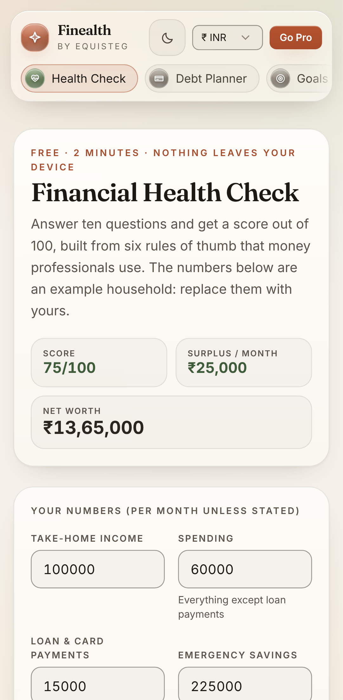

## 4.5 With Pro
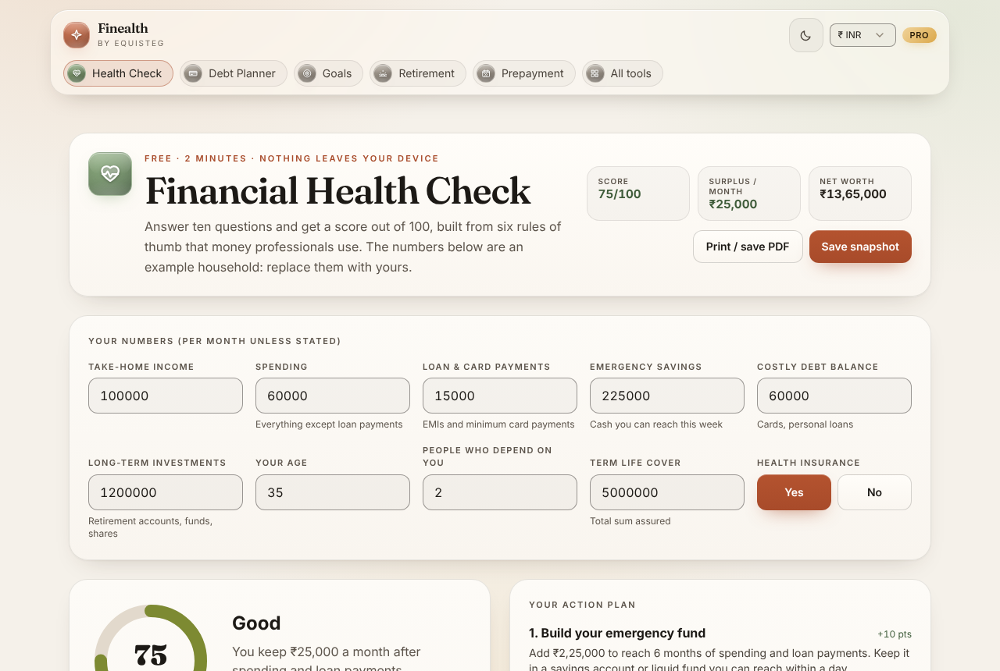

With Pro you see **Your action plan** (every action, ranked by points) and **Six pillars** (each rule's score, your measure, the rule of thumb and its weight). Two buttons appear at the top:

- **Print / save PDF** opens your browser's print window. Choose "Save as PDF" to keep a copy. The form and buttons are left out of the printout.
- **Save snapshot** stores today's score, pillar scores and net worth in this browser. See your progress on My Plan (section 9).

# 5. Debt Payoff Planner
The debt planner shows when you will be debt-free, how much interest you will pay, and which order clears your debts fastest.

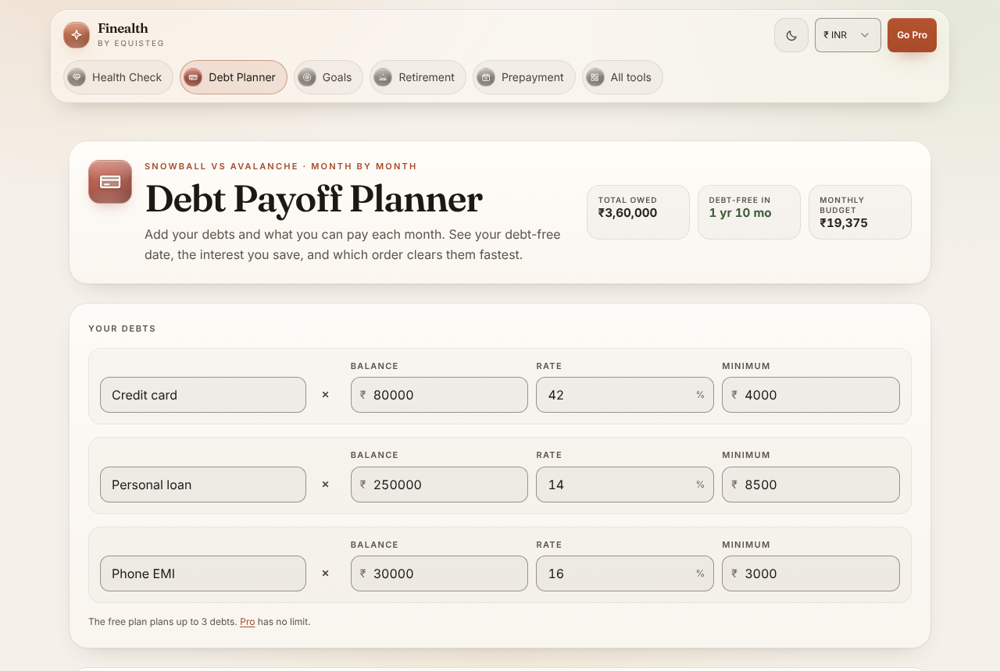

## 5.1 How to use it
1. Under **Your debts**, type each debt's name, **Balance** (what you owe now), **Rate** (yearly interest, %) and **Minimum** (the smallest monthly payment). Press **✕** to remove a debt. Press **+ Add a debt** to add one.
2. Under **Your monthly budget**, enter the **Extra on top of the minimums** you can pay. The hint shows the total of the minimums and what you will pay each month. Finealth starts with 25 % extra.
3. Choose a **Strategy**:
   - **Avalanche (highest rate first)** pays the highest interest rate first. It costs the least interest.
   - **Snowball (smallest balance first)** pays the smallest balance first. You clear a debt sooner, which keeps some people going.
   - **My order** follows the order of your list.

Your debts are saved in this browser. The extra amount and strategy go back to their defaults when you reload the page.

## 5.2 Reading the result
- **Debt-free in:** years and months until every debt is paid.
- **Total interest:** the interest you will pay with this plan.
- **Saved vs minimums:** the interest you save, and how much sooner you finish, compared with paying only the minimums.
- A sentence compares avalanche with snowball for your debts.
- **Payoff order:** when each debt is cleared and the interest it costs.

The tiles at the top show the total owed, the debt-free time and your monthly budget (₹3,60,000, 1 yr 10 mo and ₹19,375 in the example).

If the plan cannot work, a red notice says why instead of a date: the budget is less than the minimums, the payments do not cover the interest, or the debts would take more than 50 years.

## 5.3 Free and Pro
The free plan plans your first **3 debts**. Extra debts stay saved, look faded and come back with Pro. With Pro:

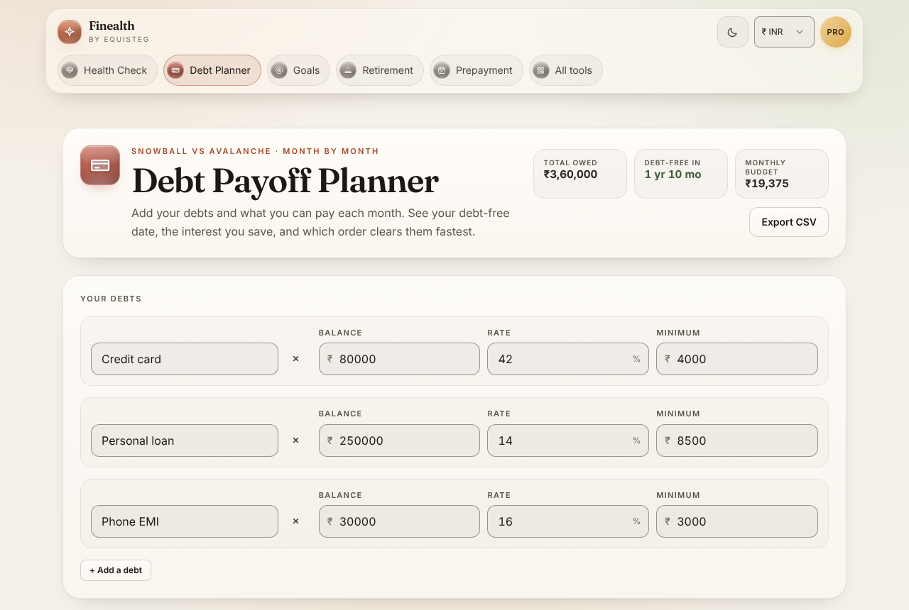

- **No limit** on debts (+ Add a debt stays available).
- **What if I paid more?** Type an extra monthly amount to see how much sooner you finish and the interest you save.
- A **chart** of your total balance over time: your plan, minimums only, and the what-if.
- **Month-by-month schedule:** open it to see each month's payment, interest and balance.
- **Export CSV** downloads the schedule as `finealth-debt-plan.csv` for a spreadsheet.

# 6. Goal Planner
The goal planner works out what each goal will really cost after inflation, and the monthly saving that gets you there.

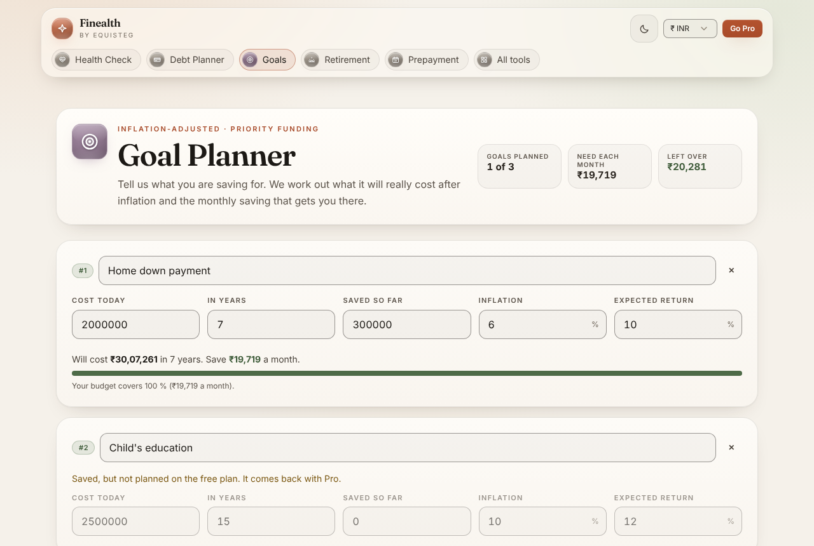

## 6.1 How to use it
1. Type the goal's name. Then enter:
   - **Cost today:** what it would cost if you bought it now.
   - **In years:** how far away it is (up to 60).
   - **Saved so far:** what you already have for it.
   - **Inflation:** how fast its price rises each year, %.
   - **Expected return:** the yearly return you expect on the money you save for it, %.
2. Under **Your monthly saving budget**, enter what you **can save each month** in total.

## 6.2 Reading the result
Under each goal: **Will cost … in … years. Save … a month.** The bar shows how much of that your budget covers. The right-hand panel shows the total **Needed for these goals** and what is **Left over**, or the **Shortfall**. Goals are funded from the top down. If there is a shortfall, push a goal out a few years, lower its cost or raise the budget.

In the example, the home down payment of ₹20 lakh today will cost ₹30,07,261 in 7 years and needs ₹19,719 a month.

## 6.3 Free and Pro
The free plan plans **one goal**. Other goals stay saved, greyed out, with the note "Saved, but not planned on the free plan. It comes back with Pro." With Pro you plan every goal from one budget, reorder them with **↑** and **↓** (the top goal is funded first), add a **Yearly step-up** (raise the saving each year), and **Export CSV** (`finealth-goals.csv`).

# 7. Retirement Planner
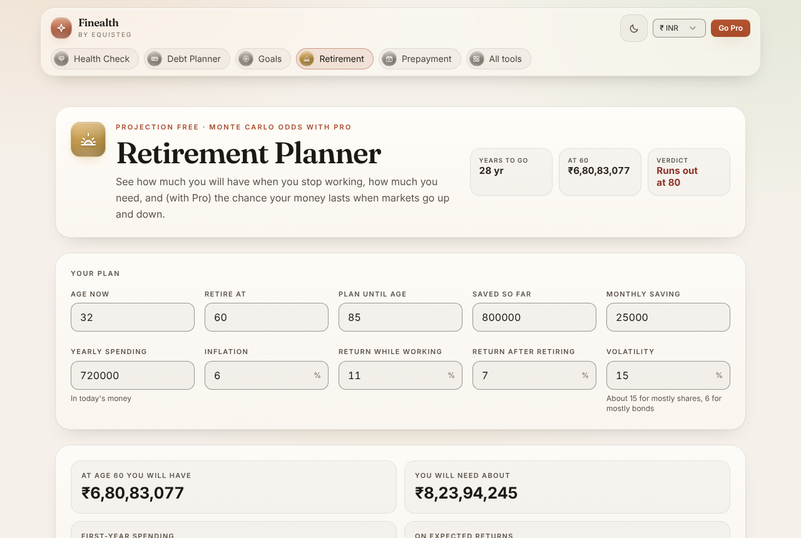

## 7.1 What to enter
| Field | What to put |
|---|---|
| Age now, Retire at, Plan until age | Your age today, when you want to stop work, and how long the money should last |
| Saved so far | Your retirement savings today |
| Monthly saving | What you add each month until you retire |
| Yearly spending | What you expect to spend each year in retirement, **in today's money** |
| Inflation | How fast prices rise each year, % |
| Return while working, Return after retiring | The yearly return you expect before and after retirement, % (usually lower after) |
| Volatility | How much returns swing from year to year: about 15 for mostly shares, 6 for mostly bonds |

## 7.2 Reading the result
- **At age … you will have:** your savings when you retire.
- **You will need about:** the savings that would last until your plan-until age.
- **First-year spending:** your yearly spending in today's money, grown by inflation to your first year of retirement.
- **On expected returns:** "Lasts to …" in green, or "Runs out at …" in red.

This projection assumes the same return every year. Real markets move up and down, so a plan that looks fine on average can still run short. In the example the money runs out at 80.

## 7.3 Retirement odds (Pro)
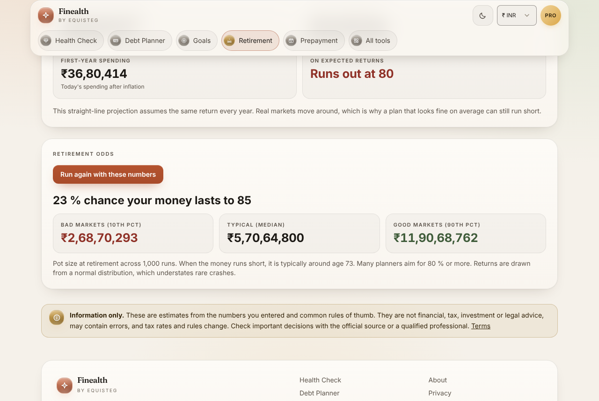

Press **Run 1,000 simulations**. Finealth runs your plan through 1,000 different market histories and shows:

- **The chance your money lasts** to your plan-until age (23 % in the example). Many planners aim for 80 % or more.
- **Bad markets (10th pct), Typical (median), Good markets (90th pct):** your savings at retirement in a poor, typical and strong run of markets.
- When the money runs short, the age it typically runs out.

The same numbers always give the same answer. Press **Run again with these numbers** after a change. The simulation uses a normal spread of returns, which understates rare crashes.

# 8. Loan Prepayment Optimiser
Paying part of a loan early? This compares the two choices your lender offers.

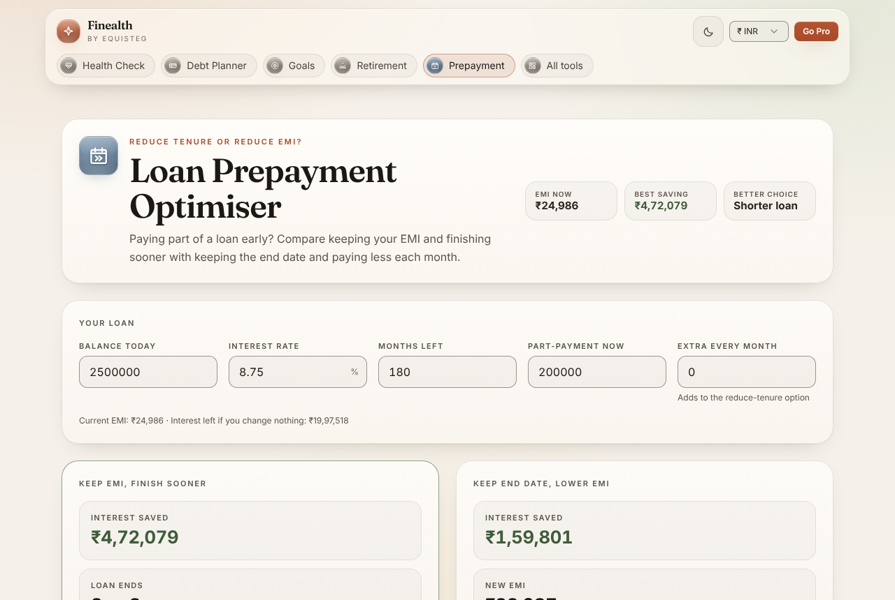

1. Enter the **Balance today**, **Interest rate**, **Months left** (up to 480), the **Part-payment now** and any **Extra every month** you plan to pay.
2. Read the line under the form: your current EMI and the interest left if you change nothing.
3. Compare the two boxes:
   - **Keep EMI, finish sooner:** the interest saved and how much sooner the loan ends. This usually saves the most.
   - **Keep end date, lower EMI:** the interest saved and your new, lower EMI. This frees cash every month.

The better choice has a green border and is named in the tiles at the top. Extra monthly payments count only in the "finish sooner" option. Check your lender's prepayment charges first. These inputs are not saved.

# 9. My Plan, backup and your data
Open My Plan from its card on the home page, from the link after saving a snapshot, or at `/my-plan/`.

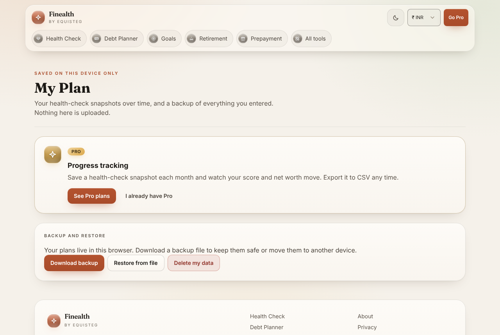

## 9.1 Progress (Pro)
After you save snapshots on the health check, My Plan shows your **Latest score**, the **Change since first** snapshot, your latest **Net worth**, and a chart of your score over time. **Export CSV** downloads `finealth-progress.csv`. **Delete snapshots** removes all snapshots after you confirm.

## 9.2 Backup and restore (free)
- **Download backup** saves everything you entered (health check, debts, goals, retirement and snapshots) to a file named `finealth-backup-<date>.json`.
- **Restore from file** loads a backup. Use it to move your plans to another browser or device. Finealth tells you which parts it restored. Files over 2 MB or files that are not Finealth backups are refused.
- **Delete my data** removes every number Finealth saved in this browser after you confirm. Your Pro licence and your light or dark choice stay.

Your numbers live only in this browser. Clearing your browser's site data, or using a private window, removes them. Keep a backup.

# 10. Privacy
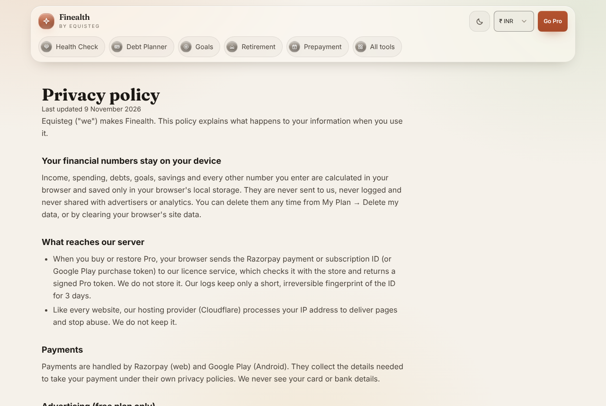

- Every number you type is worked out in your browser and saved only in your browser. It is never sent to Finealth, never logged, and never shared with advertisers or analytics.
- When you buy or restore Pro, your browser sends only your licence ID (a `pay_…` or `sub_…` ID) to the licence service, which checks it with the payment provider. It is not stored.
- Razorpay (web) and Google Play (Android) take your payment. Finealth never sees your card or bank details.
- Free users may see Google AdSense ads. In the EEA, UK and Switzerland you are asked for consent first. Pro users load no ad code at all.

Read the full policy from **Privacy** in the footer.

# 11. Calculators
## 11.1 All tools
Press **All tools** in the top bar.

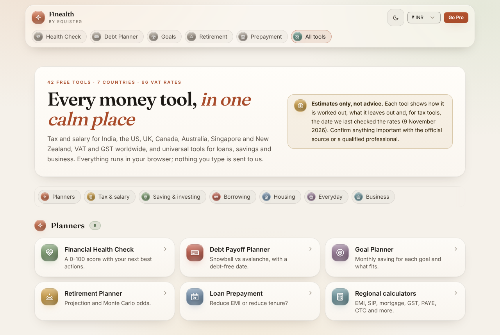

The page lists the planners and the 36 calculators by group. Press a group name (Planners, Tax & salary, Saving & investing, Borrowing, Housing, Everyday, Business) to jump to it.

| Group | Calculators |
|---|---|
| Tax & salary | India old vs new regime (detailed), HRA exemption, gratuity, US federal tax and paycheck, Australia, Canada, Singapore and New Zealand income tax, salary converter |
| Saving & investing | Inflation, real return, CAGR, Rule of 72, simple interest, recurring deposit (RD), savings goal, retirement corpus, PPF, XIRR |
| Borrowing | Credit card payoff, loan affordability, loan true cost (APR with fees), flat rate vs reducing rate |
| Housing | Rent vs buy, UK stamp duty (SDLT) with surcharges |
| Everyday | 50/30/20 budget, emergency fund, net worth, percentage, discount, tip and bill split |
| Business | World VAT / GST (66 countries), Canada GST / HST / PST, NPV and IRR, profit margin and markup, break-even |

## 11.2 Using a calculator
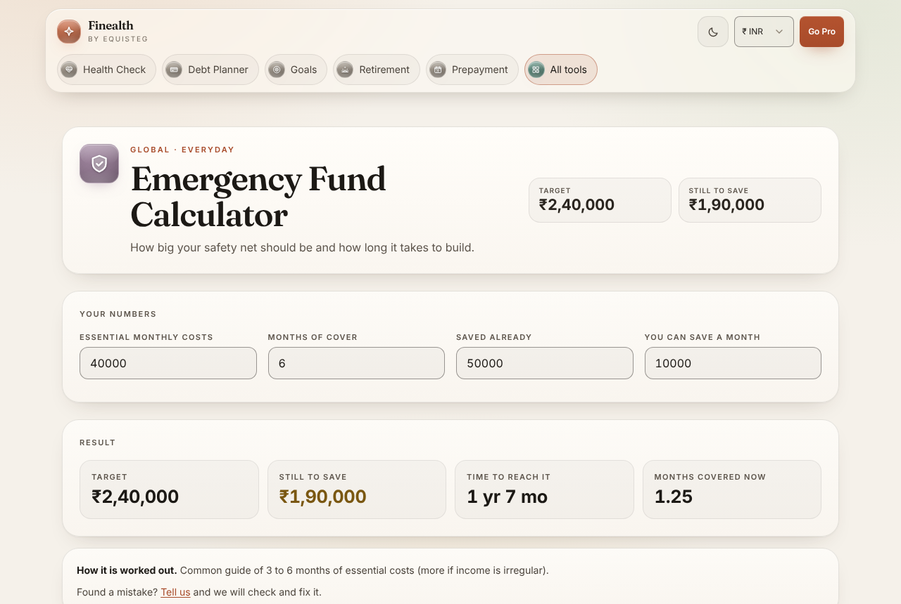

Each calculator has the same layout:

1. **Your numbers:** fill in the fields. Some are menus or tick boxes. Amounts use the currency from the top bar, except country tax tools, which always use that country's currency.
2. **Result:** the answer updates as you type. The first tile is the main answer; it is repeated in the tiles at the top.
3. **How it is worked out:** the formula or rule used, and where it comes from.
4. For tax tools, **Rates last checked** (9 November 2026) with a link to the official calculator. **Not covered** says what the tool leaves out.
5. **Found a mistake? Tell us** opens the contact page.

In the example, ₹40,000 of essential monthly costs and 6 months of cover give a target of ₹2,40,000. With ₹50,000 saved and ₹10,000 a month, it takes 1 yr 7 mo.

Calculator inputs are not saved. If the inputs do not make sense, the result says "Check the inputs".

## 11.3 India tax: old vs new regime
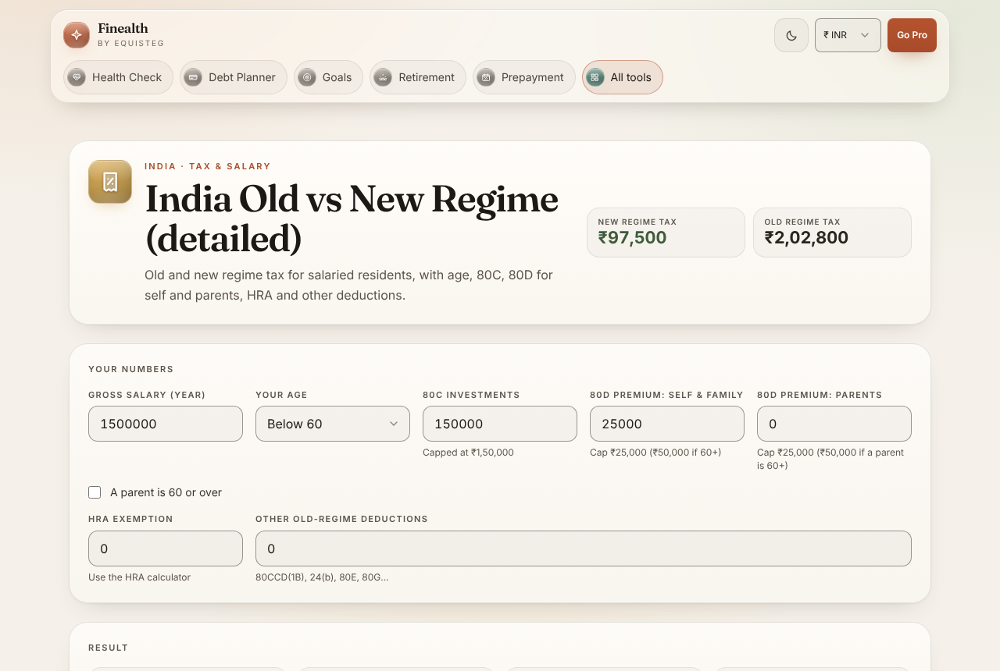

Enter your **Gross salary (year)**, **Your age** band, **80C investments** (capped at ₹1,50,000), **80D premium: self & family** and **80D premium: parents** (each capped at ₹25,000, or ₹50,000 for anyone 60 or over), tick **A parent is 60 or over** if it applies, then your **HRA exemption** (use the HRA calculator) and **Other old-regime deductions**. The tiles show the tax under each regime; the lower one is in green. In the example a ₹15 lakh salary pays ₹97,500 under the new regime and ₹2,02,800 under the old one.

## 11.4 SIP, EMI and compound interest
These three calculators have their own pages, linked from the home page. Move a slider and the answer changes at once. Each page has its own currency chips (INR, USD, EUR, GBP) at the top right.

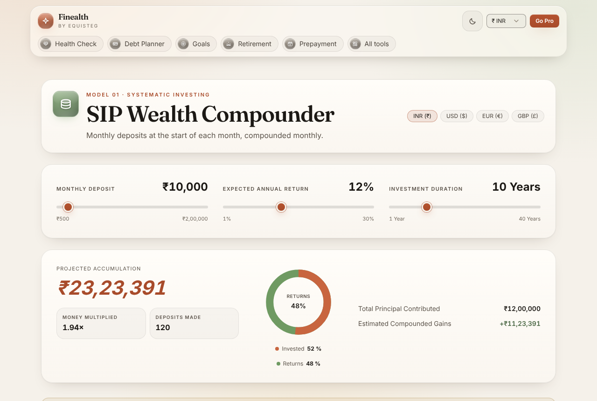

**SIP:** choose the **Monthly deposit**, **Expected annual return** and **Investment duration**. Deposits are made at the start of each month and compound monthly. The result shows the **Projected accumulation**, how many times your money multiplied, the number of deposits, what you put in and the gains. ₹10,000 a month for 10 years at 12 % grows to ₹23,23,391.

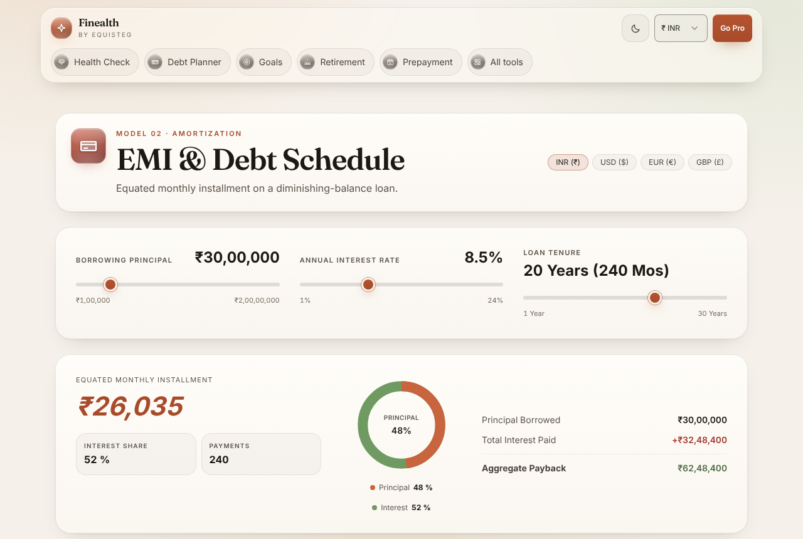

**EMI:** choose the **Borrowing principal**, **Annual interest rate** and **Loan tenure**. The result shows the monthly instalment, the share that is interest, the number of payments, the total interest and the total you pay back. ₹30 lakh at 8.5 % for 20 years costs ₹26,035 a month.

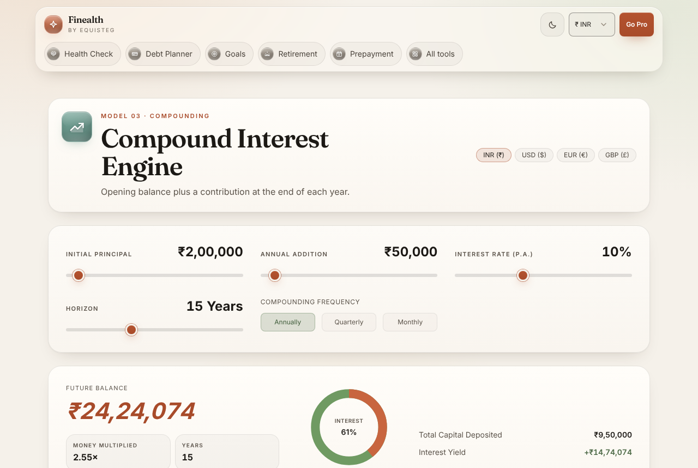

**Compound interest:** choose the **Initial principal**, **Annual addition** (added at the end of each year), **Interest rate**, **Horizon** and **Compounding frequency** (annually, quarterly or monthly). The result shows the future balance, what you deposited and the interest earned.

The **Quick calculators** section on the home page has more tools for the country of your currency: for ₹ INR, loan EMI, SIP with step-up, income tax new vs old, GST split, bank FD and post-office RD, and CTC to in-hand salary; for $ USD, mortgage, 401(k) and Roth IRA, paycheck and sales tax; for £ GBP, mortgage, ISA, PAYE and stamp duty; for € EUR, Euribor mortgage, compound growth and VAT by country.

# 12. Finealth Pro
## 12.1 Free and Pro
| | Free | Pro |
|---|---|---|
| Every calculator and country tax tool | Yes | Yes |
| Health check | Score, grade and your top priority | Every action ranked, all six pillars, print or save as PDF, snapshots |
| Debt planner | Up to 3 debts | Unlimited, what-if, chart, month-by-month schedule, CSV |
| Goal planner | 1 goal | Unlimited, priority order, yearly step-up, CSV |
| Retirement | Projection | Plus 1,000-run odds |
| Loan prepayment | Yes | Yes |
| My Plan | Backup, restore, delete | Plus progress tracking and CSV |
| Ads | Yes | None: no ad code loads at all |

| Plan | India | Elsewhere | Where to buy |
|---|---|---|---|
| Yearly | ₹199 a year (about ₹17 a month) | US$7.99 a year | Website |
| Lifetime | ₹499 once | US$19.99 once | Website |
| Monthly | ₹29 a month | US$0.99 a month | Android app only, through Google Play (not yet available in the current app) |

Pro buys software features, not advice.

## 12.2 Buying Pro on the website
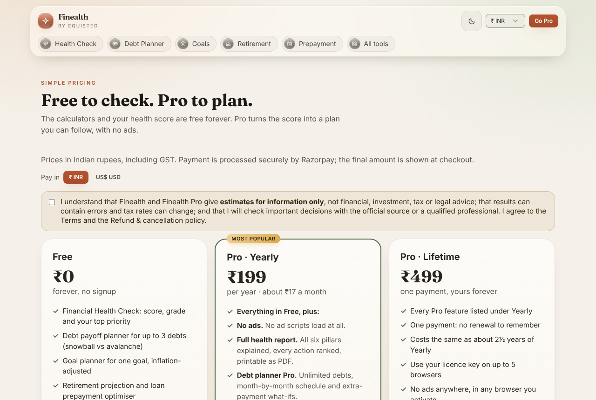

1. Open **Pricing** (or press **Go Pro**).
2. Under **Pay in**, choose **₹ INR** (prices include GST) or **US$ USD**.
3. Tick the box to confirm you understand that Finealth gives estimates for information only, not advice, and that you agree to the Terms and the Refund & cancellation policy. The buy buttons stay off until you tick it.
4. Press the button on **Pro · Yearly** or **Pro · Lifetime**. Razorpay's secure window opens. Pay by card, UPI or net banking. Razorpay asks for your email or phone; Finealth never sees them.
5. Pro switches on at once: ads disappear and every Pro feature unlocks.
6. **Copy your licence key** shown in the green box (press **Copy**). It starts with `sub_` for Yearly or `pay_` for Lifetime. It is also in your Razorpay receipt email.

If the buttons say **Coming soon**, buying is not switched on for this site yet. If US dollar payments are not ready, you see "International payments are not enabled yet."

If your payment went through but Pro did not switch on (for example, the connection dropped), Finealth shows the ID to keep and tries again by itself on your next visits. Nothing is lost. You can also paste the ID on Restore Pro.

## 12.3 Using Pro on another browser or device
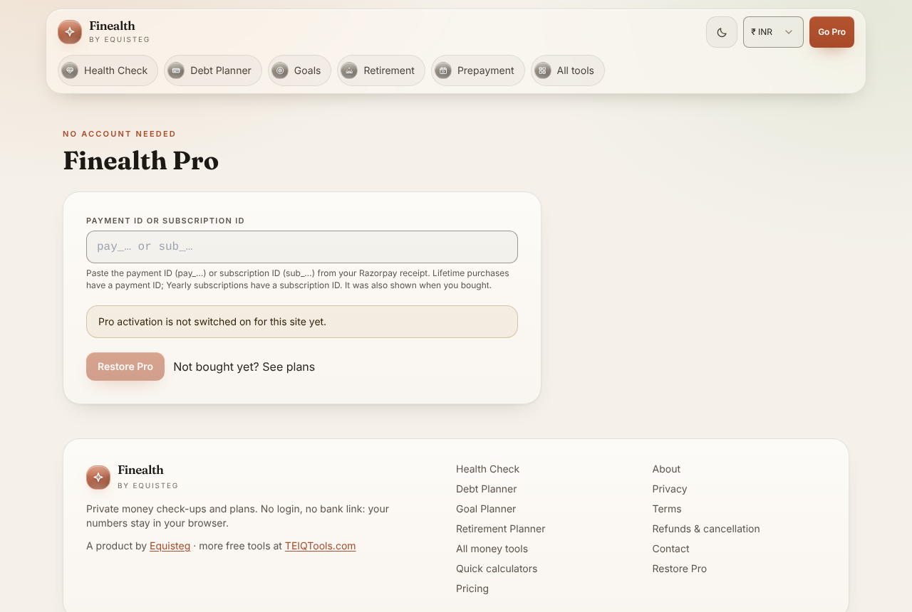

1. Open **Restore Pro** from the footer (or **I already have Pro** on any Pro card).
2. Paste your **Payment ID or subscription ID** (`pay_…` or `sub_…`).
3. Press **Restore Pro**.

One key works in up to **5 browsers**. When Pro is active, this page shows your plan, where you bought it, when it is next checked, and **Remove Pro from this browser**.

If the page says "Pro activation is not switched on for this site yet", Pro is not available on that copy of the site (as in the picture, taken on a test build).

## 12.4 How Pro stays on
Finealth checks your purchase with the payment provider about once a week, in the background. You do not need to do anything. If you are offline, Pro keeps working until the last check runs out; then you see "Couldn't confirm Pro — retrying." and Finealth tries again every minute. Ads stay off meanwhile.

## 12.5 Cancelling and refunds
- **Refund:** email support within 14 days of paying, with your payment or subscription ID. You get the full amount back to the original payment method, usually within 5-7 working days.
- **Cancel Yearly:** email your `sub_` ID, or use the link in your Razorpay subscription email. Pro stays on until the end of the year you paid for.
- **After a refund** Pro switches off within 7 days. Your plans stay and keep working on the free plan.
- **Android purchases** are managed in the Play Store under Payments & subscriptions.

# 13. The Android app
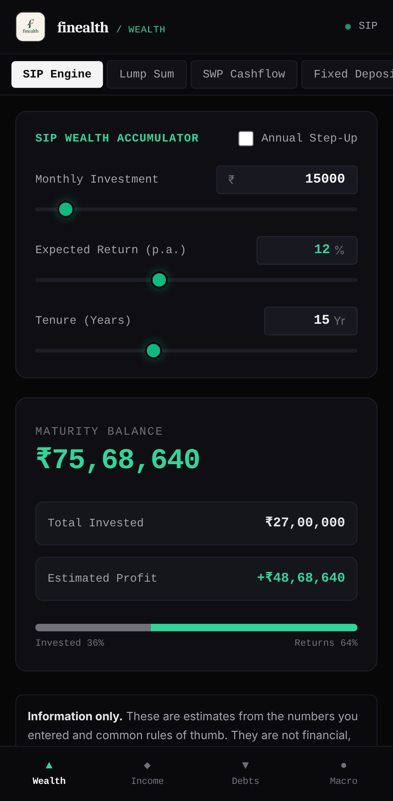

The current Android app is a set of calculators. It does not yet have the health check, the planners or Pro. After a short splash screen it shows four tabs at the bottom:

| Tab | Calculators (along the top) |
|---|---|
| **Wealth** | SIP Engine (with an Annual Step-Up option), Lump Sum, SWP Cashflow, Fixed Deposit |
| **Income** | In-Hand Salary, Tax: New vs Old, GST Calculator |
| **Debts** | Loan & EMI, Loan Compare |
| **Macro** | Purchasing Power, FIRE Freedom |

Type a number in the box or move the slider. The result card updates at once. In the picture, ₹15,000 a month for 15 years at 12 % gives a maturity balance of ₹75,68,640, of which ₹27,00,000 is what you put in.

Under every result the app shows the same **Information only** note as the website: the figures are estimates, not advice. The app works offline and saves nothing you type. A new version with the full Finealth website features is being built.

# 14. Troubleshooting
| What you see | What to do |
|---|---|
| "Couldn't confirm Pro — retrying." | You are offline or the licence check is busy. Pro switches back on by itself; ads stay off meanwhile |
| "That ID was not recognised…" | Paste the `pay_…` or `sub_…` ID exactly as in your receipt, with no spaces |
| "This licence key has been activated on too many browsers…" | Email support with your ID to reset the count |
| "This payment is still processing…" | Wait a few minutes and press Restore Pro again |
| "Too many attempts. Please wait a minute and try again." | Wait one minute |
| "This purchase was refunded…" or "This subscription has ended…" | Pro has ended in this browser. Buy again on Pricing if you want it back |
| "Your monthly budget is less than the total of the minimum payments." | Raise the extra amount so the budget covers every minimum payment |
| "Your payments do not cover the interest…" | Raise a debt's minimum or your extra amount |
| A goal shows "Shortfall" | Push the goal out, lower its cost or raise your monthly saving budget |
| "Check the inputs" on a calculator | One of the numbers does not make sense for that tool. Check each field |
| "That file is not a Finealth backup." | Choose the `.json` file Finealth downloaded, not a CSV |
| My numbers are gone | You may have cleared site data, used a private window or another browser. Restore from a backup file |
| My numbers show the wrong currency symbol | Pick your currency in the top bar. Finealth does not convert numbers already typed |
| A debt or goal looks faded | It is above the free limit. It stays saved and comes back with Pro |

# 15. Questions
**Is Finealth free?** Yes. Every calculator, the health score with your top priority, and the debt, goal, retirement and prepayment planners are free with ads. Pro is optional.

**Where are my numbers stored?** Only in this browser, on this device. Use **Download backup** on My Plan to keep a copy or move it.

**Do I need an account?** No. Pro is unlocked with the payment or subscription ID from your receipt.

**Do you link to my bank?** No, on purpose.

**How is the score worked out?** From six rules of thumb (section 4.3). Each gives points and the score is the total out of 100.

**Is this financial advice?** No. Finealth gives estimates and general rules of thumb from the numbers you enter. It does not recommend any product.

**How accurate are the results?** Formulas are tested against independent calculations, and tax tools show when their rates were last checked. Every result is still an estimate and can contain errors. Confirm important figures with the official source.

# 16. Contact
Email **support@equisteg.com**, or use the **Contact** page. For Pro questions, include your licence ID. Never send card details or passwords.
